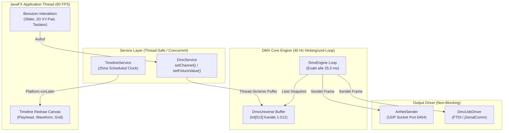
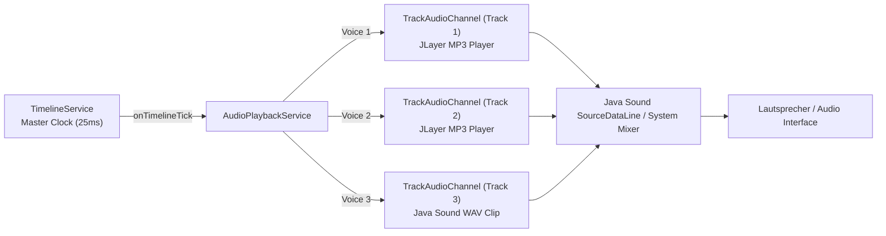

# JDMX Technische Architektur & Signalflüsse

Diese Dokumentation beschreibt die internen technischen Mechanismen von JDMX: Timing-Modelle, Thread-Verhalten, Netzwerk-Protokolle, Audio-Pipelines und Datenhaltung.

---

## 1. DMX512-Timing & Threading-Modell

Ein DMX512-Controller muss absolute zeitliche Präzision gewährleisten. Ruckelnde DMX-Signale führen zu sichtbarem Flackern bei LED-Scheinwerfern und ruckelnden Bewegungen bei Moving-Heads.

### Die 40-Hz-DMX-Schleife (`DmxEngine.java`)
* Standard-DMX sendet zwischen 30 und 44 Pakete pro Sekunde.
* JDMX nutzt einen getakteten Hintergrund-Thread (`ScheduledExecutorService`), der **exakt alle 25 Millisekunden** (entspricht 40 Hz) einen kompletten DMX-Frame mit 512 Byte Werten an alle aktiven Ausgänge (Art-Net / USB) überträgt.
* Selbst wenn die grafische Oberfläche (JavaFX) kurzzeitig stark ausgelastet ist, sendet die `DmxEngine` absolut unterbrechungsfrei weiter.

---

## 2. DMX Core-Regeln: HTP, LTP & 16-Bit Pan/Tilt

Bei Moving-Heads und Scheinwerfern gelten strikte Mischregeln (`DmxUniverse.java`):

### 1. HTP (Highest Takes Precedence) – Gilt nur für Intensität / Dimmer
* Wenn mehrere Quellen (z. B. ein Szenenfader und ein Grand Master) auf denselben Dimmer-Kanal wirken, gewinnt immer der **höhere Wert**:
  $$\text{DMX}_{\text{Out}} = \max(\text{Wert}_A, \text{Wert}_B)$$

### 2. LTP (Latest Takes Precedence) – Gilt für Pan, Tilt, Farbe, Gobo, Shutter
* Bei Farbwechseln oder Bewegungen gilt immer der **zuletzt empfangene Befehl**.
* **Schutz vor Wegdrehen (Kritische Regel):**  
  Grand Master und Blackout dürfen **niemals** Pan- oder Tilt-Kanäle auf 0 setzen! Wenn der Blackout aktiviert wird, schließt sich ausschließlich der Shutter/Dimmer. Die Moving-Heads bleiben exakt an ihrer Position stehen, anstatt unkontrolliert in die Null-Position zu fahren.

### 3. 16-Bit Pan/Tilt Feinauflösung
Moving-Heads besitzen 16-Bit-Schrittmotoren. Dafür werden zwei DMX-Kanäle kombiniert:
* **Coarse-Kanal (Grob):** Höchstwertiges Byte (MSB).
* **Fine-Kanal (Fein):** Niedrigstwertiges Byte (LSB).
* **Umrechnung (Normalisierter Wert $0.0 \dots 1.0$):**
  $$\text{DMX}_{16} = \text{round}(\text{Wert} \times 65535)$$
  $$\text{Coarse} = (\text{DMX}_{16} \gg 8) \ \& \ \text{0xFF}$$
  $$\text{Fine} = \text{DMX}_{16} \ \& \ \text{0xFF}$$

---

## 3. Art-Net UDP-Protokoll (`ArtNetPacketBuilder.java`)

Art-Net überträgt DMX512-Daten über Standard-Ethernet (UDP):

* **Standard UDP-Port:** `6454` (`0x1936`).
* **Pakettyp für DMX:** `OpOutput` (`0x5000`, Little-Endian im Paket als `0x00 0x50`).
* **Header-Aufbau:**
  1. `Art-Net\0` (8 Byte ASCII-Identifikation mit Null-Terminator).
  2. `OpCode` (2 Byte: `0x00 0x50` für DMX Data).
  3. `ProtVer` (2 Byte: `14` $\rightarrow$ `0x00 0x0E`).
  4. `Sequence` (1 Byte Zähler für Paket-Reihenfolge).
  5. `Physical` (1 Byte Port-Nummer).
  6. `SubUni / Net` (2 Byte: Universum-Adresse 0–32767).
  7. `Length` (2 Byte Big-Endian, exakt 512).
  8. `Data` (512 Byte DMX-Kanalwerte 1–512).

---

## 4. Multitrack Audio-Playback-Architektur

Die Audio-Engine in `AudioPlaybackService.java` ermöglicht simultanes, spurunabhängiges Abspielen beliebig vieler Audiodateien parallel zur Show-Timeline:

### MP3-Seeking mit Frame-Genauigkeit (JLayer)
* MP3-Dateien besitzen keine feste Millisekunden-Adressierung im Header.
* Ein MPEG-1 Layer-III Frame bei einer Abtastrate von 44.1 kHz umfasst exakt 1.152 Audio-Samples:
  $$\text{Dauer pro Frame} = \frac{1152}{44100} \approx 26.122\text{ ms}$$
* **Startframe-Berechnung beim Seeking:**
  $$\text{StartFrame} = \text{round}\left(\frac{\text{Offset}_{\text{ms}}}{26.122}\right)$$
  Der JLayer `AdvancedPlayer` überspringt beim Start blitzschnell alle Frames bis zu dieser Position und startet die Tonausgabe ohne spürbare Latenz.

### Unterbrechungsfreier Live-Resync beim Clip-Verschieben
* Wenn ein Clip während der Wiedergabe verschoben wird:
  1. Während des kontinuierlichen Mausziehens fängt ein **80-ms-Debounce-Timer** die 60+ Hz Mausevents ab, um ein Überlasten der Soundkarten-Linie zu verhindern.
  2. Sobald die Maustaste losgelassen wird (`onMouseReleased`), erfolgt ein **Sofort-Resync (0 ms)**:  
     Liegt die Playhead-Linie im Clip, springt der Song nahtlos an die neue relative Position. Liegt der Clip vor oder hinter dem Playhead, wird der Audiokanal automatisch gestoppt oder gestartet.

---

## 5. Relationale Persistenz & Datenbank (`ProjectStorageService.java`)

JDMX speichert Show-Dateien und Konfigurationen relational und transaktionssicher:

* **Engine:** Eingebettete **H2 Database** (`jdbc:h2:mem:...` im RAM für Tests, `jdbc:h2:file:...` für Shows).
* **Connection-Pooling:** **HikariCP** für verzögerungsfreie, thread-sichere Datenbankzugriffe.
* **Format:**
  * Projekt-Metadaten (Name, Erstellungsdatum, DMX-Routing).
  * `fixtures` (Gepatchte Geräte, Universum, Startadresse, Kanallayout).
  * `timeline_tracks` (Spurnamen, Songdateien, Offsets `startTimeMs`, Mute-Zustand).
  * `chaser_steps` & `presets` (Lichtstimmungen, Faderwerte, Fade-Zeiten).
