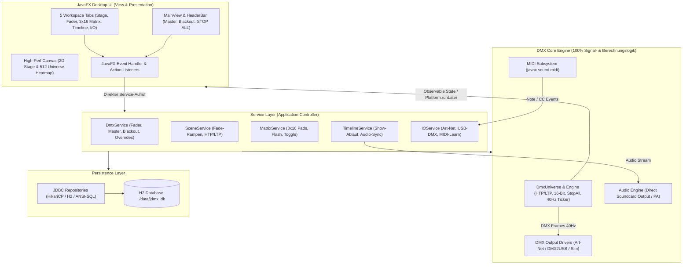

# Spezifikation: jdmx (Java DMX Controller)

> **Verbindliche Master-Spezifikation für die Software-Entwicklung**  
> Basierend auf den Anforderungen für den Vereins- und Bühnenbetrieb mit statischem Licht (Dimmer/PARs) und bewegtem Licht (Moving Heads, Scanner).  
> Konzeptionell angelehnt an die bewährte Trennung von QLC+ (Fader Desk, 2D Stage, Virtual Console, Timeline & I/O Matrix) in Kombination mit der modernen **KaSo 2.0 Dark Mode Ästhetik**.
>
> ### 🛑 Eiserne Leitplanken für das Projekt:
> 1. **STRIKTE MVC-ARCHITEKTUR (100% KERNLOGIK):**
>    - **Sämtliche Logik gehört in den Core & Service-Layer:** DMX-Berechnungen, HTP/LTP-Merging, Fades, Überblendungen, Chaser/FX-Engines, Audio-Sync, Grand Master/Blackout/Stop-All, Adresskollisionen und Treiber-Kommunikation laufen **ausschließlich im Java-Kern (`de.exit.jdmx.core` / `service`)**.
>    - **JavaFX ist reine View & Event-Dispatcher:** Die JavaFX-Benutzeroberfläche (`de.exit.jdmx.ui`) visualisiert lediglich den aktuellen Zustand (Observable Properties / Events) und leitet Benutzerinteraktionen (Slider, Buttons, XY-Pad) unverzüglich als Service-Aufrufe weiter. **Keine DMX-Geschäftslogik, DMX-Berechnungen oder Timing-Steuerung in UI-Controllern.**
> 2. **LÜCKENLOSE DOKUMENTATION (BACKEND & JAVAFX UI):**
>    - **JavaDoc:** 100% **JavaDoc** auf allen Klassen, Interfaces, Records, Enums, Feldern und Methoden (`@param`, `@return`, `@throws`, Threading-Garantien, Architektur-Begründung) im Core sowie in allen JavaFX UI-Klassen.
> 3. **LEBENDIGES ANFORDERUNGSMANAGEMENT (LIVING REQUIREMENTS):**
>    - Anforderungen werden von Beginn an strukturiert dokumentiert (siehe Abschnitt 8).
>    - Neu aufkommende oder sich ändernde Anforderungen während der Entwicklung werden **sofort schriftlich festgehalten**, der bestehende Teil wird angepasst und im Anforderungs-Changelog dokumentiert.
> 4. **STRIKTES TEST-DRIVEN DEVELOPMENT (TDD):**
>    - Tests ZUERST mit JUnit 5 vor der Implementierung. Vor jedem Compile/Build zwingend `mvn test` (100% grün).

---

## 1. Vision & Einsatzszenario

- **Ziel:**  
  Ein modularer, latenzarmer DMX-512 Controller in Java 21 LTS mit direkt integrierter, nativer **JavaFX 21 Desktop-Oberfläche** (kein Web-Browser, kein Javalin, kein REST/SSE-Overhead).
- **Kontext:**  
  Ausstattung für Vereinsräume, Säle und Bühnen. Typisches Rigging: **U-Traverse, die auf eine Wand gerichtet ist**, bestückt mit statischen Scheinwerfern und Moving Lights.
- **Benutzergruppen:**  
  - *Lichttechniker:* Detailkontrolle über Fader, 16-Bit Pan/Tilt, DMX-Adressierung und Fixture-Profile.
  - *Vereinsmitglieder / DJs / Theke:* Einfache Live-Bedienung über ein tastendes/rastendes 3×16-Pad-Raster (Cues, Farben, Intensitäten, Chaser) direkt am Touchscreen/Monitor.

---

## 2. Die 5 Haupt-Tabs & Permanenter Global-Header

Die JavaFX Desktop-Anwendung besitzt einen **permanent über allen Ansichten sichtbaren Global-Header** (`HeaderBar.java`) sowie fünf dedizierte Arbeitsbereiche (Workspaces / Tabs):

```text
┌─────────────────────────────────────────────────────────────────────────────────────────────────────────┐
│ [ jdmx ]  Grand Master: [████████░░] 80%  [● BLACKOUT]  [■ STOP ALL]  [Traffic: ▄▆█ 40Hz]               │
├─────────────────┬───────────────────┬──────────────────────┬──────────────────────┬─────────────────────┤
│ [1] 2D STAGE    │ [2] FADER         │ [3] LIVE MATRIX      │ [4] TIMELINE         │ [5] INPUT / OUTPUT  │
│     & FIXTURES  │     & UNIVERSE    │     (3x16 CONSOLE)   │     (AUDIO & SHOW)   │     (ARTNET/MIDI)   │
└─────────────────┴───────────────────┴──────────────────────┴──────────────────────┴─────────────────────┘
```

### Permanenter Global-Header (Immer verfügbar)
1. **Grand Master Fader:** Skaliert lineare Gesamthelligkeit (0–100%) ausschließlich für Dimmer/Shutter.
2. **Globaler Blackout-Button (`● BLACKOUT`):** Schaltet sofort alle Dimmer/Shutter aus (Pan/Tilt bleibt unangetastet).
3. **Globaler Haupt-Stop-Button (`■ STOP ALL / RELEASE ALL`):**
   - **Das Anti-QLC+-Feature:** Im Gegensatz zu QLC+ (wo Fader Desk, 2D-Monitor und Virtual Console jeweils separate, versteckte Override- und Stop-Buttons haben) stoppt dieser eine Button **sofort alles**:
     - Beendet alle aktiven Chaser, FX-Engines, Fades und Szenen.
     - Deaktiviert alle aktiven Tasten in der 3×25 Live-Matrix.
     - Setzt alle manuellen Fader-Overrides zurück.
     - Bringt das gesamte Universum in einen definierten Ruhezustand (keine "feststeckenden" Kanäle mehr).
4. **DMX-Traffic Live-Balkendiagramm (wie in DMXControl):**
   - Permanente Miniaturanzeige im Header und Detailanzeige in Tab 5.
   - Zeigt in Echtzeit als Balken:
     - **Frame-Rate (Hz / FPS):** Z. B. 30 Hz – 44 Hz Soll/Ist.
     - **DMX-Bus-Traffic & Aktivität:** Wieviele Kanäle ändern sich gerade, Leitungs-Durchsatz und Paket-Verkehr.
   - Farbcodiert: Grün (optimaler DMX-Fluss, 30–44 Hz), Gelb (erhöhte Latenz), Rot (Buffer-Drop/Stillstand).

---

### Tab 1: 2D Stage & Fixture-Patch (U-Traverse & Wand)
- **Zweck:** Räumliche Anordnung, Adressierung und intuitive Ausrichtung von Moving Lights (primäre visuelle Arbeitsfläche nach QLC+-Vorbild).
- **Funktionen:**
  - **2D-Bühnenplan:**
    - Schematische Abbildung des Raums: Konfigurierbare **U-Traverse** (Linker Schenkel, Querseite, Rechter Schenkel) und gegenüberliegende **Projektionswand**.
    - Platzierung von Fixtures via Drag & Drop oder Koordinaten.
    - Visuelle Lichtkegel (Beams), die in Echtzeit Farbton, Dimmer-Status und Schwenkwinkel (Pan/Tilt) an die Wand werfen.
  - **Fixture-Verwaltung:**
    - Anlegen/Bearbeiten von Geräten (Dimmer, RGB, RGBW, Moving Head 16-Bit, Custom).
    - Adressbelegungs-Balken (1–512) mit visueller Kollisionswarnung.
  - **Quick-Inspector (Klick auf ein Fixture):**
    - **2D-XY-Pad:** Intuitive Maus- oder Touch-Steuerung für Pan/Tilt.
    - **Invertierung:** Checkboxen für *Pan invertieren* und *Tilt invertieren* (essenziell für gespiegelte Köpfe an den beiden U-Schenkeln).
    - **Pan/Tilt Limits:** Min/Max-Begrenzer (Software-Limiter), damit Moving Heads den gewünschten Wandbereich nicht verlassen und nicht in Decke oder Publikum strahlen.
    - **RGBW-Farbwähler & Schnell-Dimmer / Shutter**.

### Tab 2: Fader Desk & Universum (Kanal-Ebene)
- **Zweck:** Diagnostik, Einleuchten, Testen und manuelles Eingreifen auf DMX-Kanal-Ebene.
- **Funktionen:**
  - **512-Kanal Fader-Raster:** Vertikale Schieberegler mit Kanalnummer, DMX-Wert (0–255) und Prozentwert (0–100%).
  - **Fixture-Gruppierung:** Kanäle können nach Geräten gruppiert ein- und ausgeklappt werden (z. B. *„Moving Head 1 [CH 1–16]“* mit Kanalbezeichnungen: *Pan, Pan Fine, Tilt, Tilt Fine, Dimmer, Color, Gobo...*).
  - **Flash-Buttons:** Für Dimmerkanäle (tastendes Setzen auf 255).
  - **High-Performance Canvas-Universe-Grid:** Live-Kompaktanzeige aller 512 Kanäle als 16x32-Raster mit Helligkeits-Visualisierung.

### Tab 3: Live Matrix / Virtual Console (Seitenbasierte Pad-Matrix)
- **Zweck:** Das intuitive Live-Bedienfeld für den Showabend – optimiert für PC, Touch-Tablets und externe MIDI-Hardware.
- **Philosophie:** Komplett offenes, modulares System ohne starre Vorlagen. Der Lichtoperator belegt sich die Pads passend zum Setup.
- **Layout (3 × 16 Pad-Matrix):**
  - **16 Spalten horizontal × 3 Reihen vertikal:** Exakt **48 unbeschriftete Pads pro Seite** in einer klaren, einheitlichen 3×16-Tabelle (mit dezentem Rhythmusabstand alle 4 Spalten).
  - **Vollständig scrollfrei (Keine Scrollbalken):** Das 3×16 Raster passt sich vollständig an den Viewport an; es gibt weder vertikale noch horizontale Scrollbalken.
  - **Seitenbasierte Organisation (Paging):** Seiten 1 bis 4 mit schneller Umschaltung im Kopfbereich. Jede Seite speichert ihren eigenen Zustand (Flash/Toggle, Farbe, Aktivität).
- **Pad-Design (Unbeschriftet & Taktil):**
  - **Keine Textbeschriftung:** Die Buttons besitzen bewusst keine Textnamen, um maximale Dichte, taktile Klarheit und blitzschnelle Übersicht wie bei professionellen Launchpads / Hardware-Controllern zu gewährleisten.
  - **Flash-Symbol oben links:** Buttons im Flash-Modus zeigen ein dezent leuchtendes Lucide-Stern-Symbol (`star`) in der oberen linken Ecke.
  - **Status-LED oben rechts:** Signalisiert den aktiven Status des Pads in Echtzeit.
  - **Farb-Akzentleiste:** Dünne, dezent illuminierte Bodenleiste zur optischen Gruppierung nach Farben.
- **Linke Edit-Sidebar & Werkzeugpalette:**
  - **Modus-Umschalter:** Schaltet per Klick zwischen `LIVE` (Normalbetrieb) und `EDIT` (Konfigurationsmodus) um.
  - **Werkzeugliste (Tools im Edit-Modus):**
    1. **Flash-Tool (Stern-Icon):** Klick auf ein beliebiges Pad schaltet dieses in den Flash-Modus um (Stern oben links erscheint/verschwindet).
    2. **Toggle-Tool:** Klick auf ein Pad versetzt es in den Standard-Rastmodus (Stern wird entfernt).
    3. **Farbe zuweisen (Farbpalette):** Zuweisung frei wählbarer Akzentfarben (Cyan/Blau, Rot, Amber, Grün, Violett, Pink, Weiß).
    4. **Zurücksetzen (Eraser):** Setzt das Pad auf Standardwerte zurück.
  - **Statusanzeige:** Live-Zähler für aktive Seite, Anzahl konfigurierter Flash-Buttons und aktive Tasten.
- **Interaktions- & Trigger-Verhalten:**
  - `FLASH` (Momentary mit Stern): Aktiviert bei Tastendruck (`mousedown` / `touchstart`), deaktiviert sofort beim Loslassen (`mouseup` / `mouseleave` / `touchend`).
  - `TOGGLE` (Latching ohne Stern): Standard-Rastverhalten – Klick schaltet ein, erneuter Klick schaltet aus.
- **Hardware-Anbindung:** Jedes Pad kann per 1-Klick MIDI-Learn direkt auf physische Controller-Pads (z. B. Akai APC Mini, Novation Launchpad) gemappt werden.

### Tab 4: Timeline (FL Studio Style Show & Music Designer)
- **Zweck:** Vorprogrammierte, mikrosekundengenaue Shows synchron zur Musik (z. B. für Showtänze oder Einmarsch-Hymnen).
- **Konzeptionelle Vorlage: FL Studio Playlist & Browser-Workflow:**
  ```text
  ┌───────────────────────┬─────────────────────────────────────────────────────────────────────────────┐
  │ [ jdmx File Explorer] │ [▶ PLAY] [■ STOP] [🔁 LOOP] [🧲 SNAP: Beat] 01:23.450 / 03:45.000   Vol:[███] │
  ├───────────────────────┼─────────────────────────────────────────────────────────────────────────────┤
  │ 📁 Audio & Songs      │ [Bar 1]       [Bar 2]       [Bar 3]       [Bar 4]       [Bar 5]             │
  │   ├─ showtanz26.mp3 ──┼─► [Line 1 (Audio):  ▄█▆▄▂  ▄█▆▄▂  ▄█▆▄▂  ▄█▆▄▂  ▄█▆▄▂  ▄█▆▄▂  ▄█▆▄▂  ]    │
  │   └─ fanfare.mp3      │                                                                           │
  │ 📁 Scenes & Cues      │                                                                           │
  │   ├─ Wand_Blau ───────┼─► [Line 2: Wand_Blau ─────────►]  [Line 2: Wand_Rot ────────────────────►]│
  │   ├─ Wand_Rot         │                                                                           │
  │   └─ Warmweiss_Garde  │                                                                           │
  │ 📁 Chasers & FX       │                                                                           │
  │   ├─ Welle_Schnell ───┼─►                 [Line 3: Welle_Schnell ───────────────►]                │
  │   └─ Strobe_Gewitter ─┼─►                                [Line 4: ⚡ STROBE 3s]                    │
  │ 📁 Fixture Groups     │                                                                           │
  │   └─ Moving_Heads_U   │ [Line 5: (Freie Spur für beliebige Clips...)                            ] │
  └───────────────────────┴─────────────────────────────────────────────────────────────────────────────┘
  ```
- **Linke Seitenleiste: Der jdmx File Explorer (Browser):**
  - Schneller Zugriff auf alle im System gespeicherten Assets per Baumstruktur:
    - 📁 **Audio & Songs:** Hochgeladene Musikdateien (MP3, WAV, OGG) mit Dauer und Format.
    - 📁 **Scenes & Cues:** Gespeicherte Lichtszenen, Farb-Presets und Positionen.
    - 📁 **Chasers & FX:** Definierte Lauflichter, Wellen-Figuren, Strobe-Impulse.
    - 📁 **Fixture Groups:** Scheinwerfergruppen (z. B. „Alle Moving Heads“, „U-Traverse“, „Frontlicht“).
  - **Drag & Drop auf die Spuren:** Jedes Element (Song, Szene, Chaser) kann einfach mit der Maus gepackt und auf eine beliebige freie Zeile (Line) der Timeline gezogen werden.
- **Rechte Hauptansicht: Multi-Line Playlist (Tracks wie in FL Studio):**
  - **Universelle Zeilen/Lines:** Spuren sind nicht starr festgelegt. Auf Track 1 kann die Audiospur liegen, auf Track 2 eine Szene, auf Track 3 ein Chaser, auf Track 4 ein Strobe-Trigger.
  - **Clip-Manipulation auf der Zeitleiste:**
    - **Verschieben & Platzieren:** Clips frei auf der Zeitachse verschieben.
    - **Länge/Dauer ziehen:** An der rechten Kante des Clips ziehen, um festzulegen, wie lange die Szene oder der Chaser aktiv bleibt.
    - **Weiche Fades (Handles):** Anfasser an den oberen Blockecken für stufenlose Fade-In und Fade-Out Rampen.
    - **Mute & Solo pro Line:** Einzelne Spuren stummschalten oder isoliert abspielen.
    - **Snap-to-Grid (Magnet-Raster):** Einrasten an Takten (Bar, Beat, 1/2, 1/4, None) für perfekte Rhythmus-Synchronisation.
- **Integrierte Audio-Wiedergabe (Ersetzt VLC vollständig):**
  - Das Audiosignal wird **direkt über den Audio-Ausgang / die Soundkarte des Computers an das Mischpult / die Hallen-PA** ausgegeben.
  - **100% Latenz- und Drift-frei:** Audio und DMX starten mikrosekundengenau synchron beim Klick auf Play (oder Druck auf die Leertaste).
  - **Scrubbing & Spulen:** Klick an eine beliebige Stelle der Zeitleiste lässt Musik und Licht synchron dorthin springen (ideal zum Einstudieren einzelner Tanz-Passagen).

### Tab 5: Input / Output (I/O) & Diagnostik
- **Zweck:** Anbindung physischer Schnittstellen für DMX-Ausgabe, externe Controller und Bus-Überwachung.
- **DMX Outputs:**
  1. **Art-Net Output (Ethernet/UDP):**
     - Sendet DMX-Frames an Art-Net Nodes im Netzwerk (Port 6454).
     - Einstellbar: Ziel-IP (Broadcast `255.255.255.255` oder Unicast wie `192.168.1.100`), Subnetz und Universe.
  2. **DMX2USB Output (Serielle Schnittstelle / FTDI):**
     - Anbindung gängiger USB-DMX-Interfaces (z. B. Enttec DMX USB Pro, FTDI OpenDMX).
     - Plattformunabhängig implementiert über `jSerialComm`.
     - Port-Auswahl (z. B. `COM3` unter Windows, `/dev/ttyUSB0` unter Linux).
  3. **Virtual Simulator Driver:**
     - Für Entwicklung und Offline-Tests ohne Hardware.
- **MIDI Input & Mapping:**
  - Erkennt angeschlossene USB-MIDI-Controller (z. B. Akai APC Mini, Korg nanoKONTROL, Behringer X-Touch).
  - **MIDI-Learn Funktion:** Klick auf einen Regler oder Matrix-Button im UI, MIDI-Taste oder Fader am Controller bewegen ➔ Automatische Zuordnung gespeichert.
  - Unterstützte Mappings:
    - Grand Master Fader
    - Blackout-Toggle
    - Einzel- oder Submaster-Fader im Fader Desk
    - Beliebige Slots in der 3×25 Live Matrix
  - **MIDI Feedback (Option):**
    - Sendet Note-On/Off-Befehle zurück an Controller mit LED-Tasten (z. B. Launchpad / APC Mini), um aktive Cues leuchten zu lassen.
- **DMX Traffic Monitor (Diagnose wie in DMXControl):**
  - Großes Echtzeit-Balkendiagramm zur Bus-Diagnose:
    - **Framerate-Verlauf (Hz / FPS):** Soll-Wert (z. B. 40 Hz) vs. Ist-Wert.
    - **Kanalaktivitäts-Balken:** Balkendiagramm der 512 Kanäle, das anzeigt, auf welchen Adressen aktuell Aktivität/Änderung stattfindet.
    - **Paket-Zähler:** Ausgegebene Pakete pro Sekunde (PPS) und Gesamtzähler.
    - **Frame-Time / DMX-Timing:** Messung der Frame-Generierungszeit in Millisekunden (Soll: < 25 ms bei 40 Hz).

---

## 3. Architektur & MVC-Schichtenmodell



### 3.1 Das MVC-Prinzip im Detail
- **Model (Datenmodell & Zustand):**
  - Repräsentiert die gesamte Datenhaltung und den Systemzustand.
  - Klassen: `DmxUniverse`, `Fixture`, `Scene`, `MatrixPad`, `TimelineShow`, `MidiMapping`, `DmxTrafficStats`.
  - Vollständige Validierungs- und Integritätsregeln liegen hier (z. B. Adresskollisionen, Grenzwerte).
- **Controller / Services:**
  - `DmxService`, `FixtureService`, `SceneService`, `MatrixService`, `TimelineService`, `IOService`.
  - Führen alle Berechnungen aus: HTP/LTP-Merging, Master-Skalierung, Pan/Tilt Limitierung, Fading-Kurven, Stop-All Release.
  - Entkopplung über Hintergrund-Threads / Virtuelle Threads.
- **View (JavaFX Benutzeroberfläche):**
  - Rein reaktive Visualisierung (`de.exit.jdmx.ui`).
  - Zeigt Werte unverzüglich auf Canvas, Slidern und Buttons an (`Platform.runLater()`).
  - Berechnet **keine** DMX-Werte, **keine** Überblendungen und **keine** Adresskollisionen vor.

### 3.2 Dokumentations- & Schnittstellen-Standards
- **JavaDoc:** 100% Abdeckung aller Klassen, Records, Interfaces, Enums, Felder und Methoden im gesamten Projekt (Backend & UI).
- **Onboarding & Architektur:** Verbindliche Leitfäden `docs/ONBOARDING.md`, `docs/ARCHITECTURE.md` und `docs/REQUIREMENTS.md`.

---

## 4. DMX Core Engine: Technische Leitregeln

### 4.1 HTP vs. LTP Merging
- **HTP (Highest Takes Precedence):**
  - Gilt ausnahmslos für **Dimmer- und Intensitätskanäle**.
  - Wenn mehrere Szenen oder Flash-Buttons denselben Dimmer ansprechen, gewinnt der höchste Wert.
- **LTP (Latest Takes Precedence):**
  - Gilt für **Pan, Tilt, Gobo, Farbe, Prisma und Shutter**.
  - Der zuletzt gesendete Befehl überschreibt den Wert – unabhängig davon, ob die Zahl größer oder kleiner ist.

### 4.2 Grand Master & Blackout-Regel
- **Grand Master:** Skaliert **ausschließlich** Kanäle vom Typ `DIMMER` und `SHUTTER` (`effektiv = (wert * master) / 255`).
- **Blackout:** Setzt **ausschließlich** `DIMMER`- und `SHUTTER`-Kanäle auf 0.
- **Verbotene Aktion:** Pan-, Tilt- oder Farbkanäle dürfen durch Grand Master oder Blackout **niemals verändert oder genullt werden**! Moving Heads müssen beim Blackout exakt auf ihrer aktuellen Position stehen bleiben.

### 4.3 16-Bit Pan/Tilt Behandlung
- Moving Heads nutzen 2 DMX-Kanäle pro Achse (Coarse = High Byte 0–255, Fine = Low Byte 0–255), entsprechend 65.536 Stufen.
- Die Engine berechnet Positionen intern als 16-Bit Integer (`0 .. 65535`) und teilt sie beim Frame-Export auf:
  - `Coarse = (value >> 8) & 0xFF`
  - `Fine   = value & 0xFF`

### 4.4 Globaler Release & Stop-All Engine Mechanismus
- Die DMX-Engine besitzt eine zentrale, thread-sichere Methode `stopAll()`:
  - **Sofortiger Abbruch:** Alle laufenden Chaser-Threads, Fading-Tasks und FX-Generatoren werden unverzüglich beendet (`cancel(true)`).
  - **Matrix-Deaktivierung:** Alle Buttons in der 3×25 Live-Matrix werden auf `active = false` gesetzt.
  - **Release aller Overrides:** Manuelle Fader-Haltungen im Fader Desk und in der 2D-Ansicht werden freigegeben.
  - **Reset des Ausgabepuffers:** Dimmer-Kanäle werden auf 0 gesetzt. Pan/Tilt-Werte verharren auf definierter Home-Position.

### 4.5 DMX-Traffic Messung & Frame-Timing
- Die `DmxEngine` erfasst kontinuierlich Diagnose-Metriken im Sendeloop:
  - **FPS-Counter:** Exakte Messung der tatsächlich erreichten Bildwiederholrate (Frames pro Sekunde).
  - **Frame-Time Tracker:** Zeitspanne in Nanosekunden/Millisekunden pro DMX-Zyklus.
  - **Delta-Analyzer:** Vergleicht Frame $N$ mit Frame $N-1$ und zählt veränderte DMX-Kanäle.
  - **Bus-Auslastungsfaktor:** Berechnet das Verhältnis von aktiven Daten zu Leerlaufzeiten für das Balkendiagramm.

---

## 5. Tech-Stack & Dateistruktur

- **Java-Version:** Java 21 LTS (Records, Virtual Threads, Pattern Matching).
- **Build-Tool:** **Apache Maven** (`pom.xml`) – Strikte Richtlinie, kein Gradle.
- **GUI-Framework:** **OpenJFX 21 LTS** (`javafx-controls`, `javafx-graphics`, `javafx-base`, `javafx-media`).
- **Plugins:** `javafx-maven-plugin` (0.0.8), `exec-maven-plugin` (3.5.0), `maven-shade-plugin` (Fat-JAR).
- **JSON:** **Jackson 2.18+** (`jackson-databind`, `jackson-datatype-jsr310`).
- **Persistenz:** **H2 Database** (`./data/jdmx_db.mv.db`) via JDBC und HikariCP. Sauberes ANSI-SQL für spätere Postgres/MySQL-Portierbarkeit.
- **Serielle Schnittstelle (USB-DMX):** `com.fazecast:jSerialComm:2.11.0`.
- **MIDI-Schnittstelle:** Java SE Standard `javax.sound.midi`.
- **Logging:** SLF4J mit `slf4j-simple`.
- **UI & Icons:** JavaFX CSS Dark Theme (KaSo 2.0 Design Tokens), Lucide-Icons (via JavaFX `SVGPath`), Canvas 2D.
- **Testing:** **JUnit 5 (Jupiter)** + Mockito / AssertJ.

### Dateistruktur
```text
jdmx/
├── pom.xml                                   # Maven Build-Deskriptor (JavaFX 21, HikariCP, H2, Shade)
├── .gitignore                                # Excludes für target/, data/, AGENTS.md
├── jdmx-spec.md                              # Master-Spezifikation (dieses Dokument)
├── INSTRUCTION.md                            # Arbeitsanweisung für Agenten
├── README.md                                 # Projekt-Übersicht & Schnellstart
├── docs/                                     # Vollständige Dokumentations-Artefakte
│   ├── ARCHITECTURE.md                       # Tiefenarchitektur & Timing-Details
│   ├── ONBOARDING.md                         # Entwickler-Einarbeitungsleitfaden
│   └── REQUIREMENTS.md                       # Strukturierter Anforderungskatalog (Living Requirements)
├── data/                                     # H2-Datenbankdateien
└── src/
    ├── main/
    │   ├── java/de/exit/jdmx/
    │   │   ├── Main.java                     # Launcher ohne Application-Extends (Fat-JAR)
    │   │   ├── App.java                      # JavaFX Application Einstiegspunkt
    │   │   ├── config/                       # AppConfig & DatabaseConfig
    │   │   ├── core/                         # DmxUniverse, DmxEngine, Drivers (ArtNet, USB, Sim)
    │   │   ├── model/                        # Records & Enums (Fixture, Scene, MatrixPad, etc.)
    │   │   ├── repository/                   # JDBC Repositories für H2/ANSI-SQL
    │   │   ├── service/                      # DmxService, FixtureService, MatrixService, etc.
    │   │   └── ui/                           # JavaFX Views, Tabs, HeaderBar & LucideIcon
    │   │       ├── MainView.java
    │   │       ├── HeaderBar.java
    │   │       ├── icons/LucideIcon.java
    │   │       └── tabs/
    │   │           ├── StageTab.java         # 2D Stage Rigging & Inspector
    │   │           ├── FaderUniverseTab.java # 512 Canvas Heatmap & Fader Desk
    │   │           ├── LiveMatrixTab.java    # 3x16 Pad Desk (KaSo 2.0 Dark Mode)
    │   │           ├── TimelineTab.java      # FL Studio Playlist & Audio Engine
    │   │           └── DiagnosticsTab.java   # Art-Net, USB, MIDI & Traffic Monitor
    │   └── resources/
    │       ├── application.properties
    │       └── de/exit/jdmx/styles/
    │           ├── dark-theme.css            # KaSo 2.0 Dark Tokens
    │           └── components.css            # Fader, Matrix-Pads, Badges
    └── test/java/de/exit/jdmx/               # TDD Unit- & Integrationstests
```

---

## 6. Datenmodell & Schemas

### 6.1 Datamodels (Records)

#### `ChannelType.java`
```java
package de.exit.jdmx.model;

public enum ChannelType {
    DIMMER, PAN, PAN_FINE, TILT, TILT_FINE, RED, GREEN, BLUE, WHITE, SHUTTER, GOBO, SPEED, OTHER;

    public boolean isIntensity() { return this == DIMMER || this == SHUTTER; }
    public boolean isPosition() { return this == PAN || this == PAN_FINE || this == TILT || this == TILT_FINE; }
    public boolean isColor() { return this == RED || this == GREEN || this == BLUE || this == WHITE; }
}
```

#### `Fixture.java`
```java
package de.exit.jdmx.model;

import com.fasterxml.jackson.annotation.JsonIgnoreProperties;
import java.util.List;

@JsonIgnoreProperties(ignoreUnknown = true)
public record Fixture(
    String id,
    String name,
    int universe,
    int startAddress,
    FixtureType type,
    List<ChannelType> channelDefinitions,
    boolean invertPan,
    boolean invertTilt,
    int minPanPercent,   // 0 - 100
    int maxPanPercent,   // 0 - 100
    int minTiltPercent,  // 0 - 100
    int maxTiltPercent,  // 0 - 100
    double stageX,       // 0.0 - 100.0 (Position auf 2D Stage)
    double stageY        // 0.0 - 100.0
) {
    public int channelCount() {
        return channelDefinitions != null ? channelDefinitions.size() : 1;
    }

    public boolean overlapsWith(Fixture other) {
        if (this.universe != other.universe) return false;
        int thisEnd = this.startAddress + this.channelCount() - 1;
        int otherEnd = other.startAddress + other.channelCount() - 1;
        return this.startAddress <= otherEnd && other.startAddress <= thisEnd;
    }
}
```

#### `SceneScope.java` & `Scene.java`
```java
package de.exit.jdmx.model;

public enum SceneScope {
    FULL,            // Schreibt alle konfigurierten Kanäle
    COLOR_ONLY,      // Schreibt ausschließlich RGB/RGBW/Farbrad-Kanäle
    INTENSITY_ONLY,  // Schreibt ausschließlich Dimmer-Kanäle
    POSITION_ONLY,   // Schreibt ausschließlich Pan/Tilt-Kanäle
    CUSTOM           // Benutzerdefinierte Kanalliste
}
```
```java
package de.exit.jdmx.model;

import com.fasterxml.jackson.annotation.JsonIgnoreProperties;
import java.util.Map;

@JsonIgnoreProperties(ignoreUnknown = true)
public record Scene(
    String id,
    String name,
    int universe,
    SceneScope scope,
    Map<Integer, Integer> channelValues, // DMX-Kanal (1-512) -> Wert (0-255)
    int fadeTimeMs
) {}
```

#### `MatrixButton.java` (3 × 25 Grid Slot)
```java
package de.exit.jdmx.model;

import com.fasterxml.jackson.annotation.JsonIgnoreProperties;

@JsonIgnoreProperties(ignoreUnknown = true)
public record MatrixButton(
    String id,
    int row,               // 1 - 3
    int col,               // 1 - 25
    String label,          // z. B. "Wand Rot", "Cue 1", "Welle"
    String colorHex,       // Farbe der Schaltfläche im UI (z. B. "#E11D48")
    ButtonType type,       // SCENE, CHASER, FLASH, OVERRIDE
    String targetId,       // Referenzierte Scene-ID oder Chaser-ID
    ButtonMode mode,       // TOGGLE, FLASH, EXCLUSIVE
    String exclusiveGroup, // z. B. "COLORS", "POSITIONS"
    boolean active         // Aktueller Live-Zustand
) {}
```

#### `MidiMapping.java`
```java
package de.exit.jdmx.model;

import com.fasterxml.jackson.annotation.JsonIgnoreProperties;

@JsonIgnoreProperties(ignoreUnknown = true)
public record MidiMapping(
    String id,
    String deviceName,
    int midiChannel,       // 1 - 16
    MidiMessageType messageType, // NOTE_ON, CONTROL_CHANGE
    int controlNumber,     // Note-Nummer oder CC-Nummer (0-127)
    MidiTargetType targetType,   // GRAND_MASTER, BLACKOUT, MATRIX_BUTTON, FADER
    String targetId        // z. B. Button-ID oder Kanalnummer
) {}
```

#### `DmxTrafficStats.java`
```java
package de.exit.jdmx.model;

public record DmxTrafficStats(
    int fps,
    int targetFps,
    long packetsSentTotal,
    int activeChannelsCount,
    int changedChannelsCount,
    double busLoadPercent,
    double frameTimeMs
) {}
```

#### `TimelineShow.java`, `TimelineTrack.java`, `TimelineBlock.java`
```java
package de.exit.jdmx.model;

import com.fasterxml.jackson.annotation.JsonIgnoreProperties;
import java.util.List;

@JsonIgnoreProperties(ignoreUnknown = true)
public record TimelineShow(
    String id,
    String name,
    String audioFileName,
    long durationMs,
    List<TimelineTrack> tracks
) {}

@JsonIgnoreProperties(ignoreUnknown = true)
public record TimelineTrack(
    String id,
    String name,
    String colorHex,
    List<TimelineBlock> blocks
) {}

@JsonIgnoreProperties(ignoreUnknown = true)
public record TimelineBlock(
    String id,
    long startMs,
    long durationMs,
    long fadeInMs,
    long fadeOutMs,
    String sceneId
) {}
```

---

## 7. Java Service- & Controller-Schnittstellen (Core API)

Anstelle einer fehleranfälligen Netzwerk- und Web-Schicht greift die JavaFX-Benutzeroberfläche direkt über typsichere Java-Services auf das Backend zu. Zustandsänderungen werden thread-sicher über JavaFX Properties bzw. Event-Listener synchronisiert.

### 7.1 Service-Methoden

| Service | Methode | Beschreibung | Parameter / Rückgabe |
| :--- | :--- | :--- | :--- |
| `DmxService` | `setChannel(universe, channel, value)` | Setzt einzelnen Kanalwert (0–255) | `(int, int, int) -> void` |
| `DmxService` | `setChannels(universe, Map<Integer, Integer>)` | Setzt mehrere Kanalwerte atomar | `(int, Map<Integer, Integer>) -> void` |
| `DmxService` | `setGrandMaster(universe, value)` | Skaliert Dimmer-Ausgabe (0–255) | `(int, int) -> void` |
| `DmxService` | `setBlackout(universe, active)` | Aktiviert/deaktiviert Blackout | `(int, boolean) -> void` |
| `DmxService` | `stopAll()` | **Globaler Stop:** Stoppt alle Fades/Chaser, löst Matrix & Overrides | `() -> void` |
| `DmxService` | `getUniverse(universe)` | Liefert das Datenmodell des Universums | `(int) -> DmxUniverse` |
| `DmxService` | `getTrafficStats()` | Liefert Live-Bus-Diagnose (FPS, Pakete, Last) | `() -> DmxTrafficStats` |
| `FixtureService` | `getAllFixtures()` | Liste aller konfigurierten Fixtures | `() -> List<Fixture>` |
| `FixtureService` | `saveFixture(fixture)` | Speichert Fixture (mit Kollisionsprüfung) | `(Fixture) -> Fixture` |
| `FixtureService` | `deleteFixture(id)` | Löscht Fixture | `(String) -> void` |
| `SceneService` | `getAllScenes()` | Liste aller gespeicherten Szenen | `() -> List<Scene>` |
| `SceneService` | `saveScene(scene)` | Speichert Szene mit Scope | `(Scene) -> Scene` |
| `SceneService` | `recallScene(id, fadeTimeMs)` | Aktiviert Szene mit Überblendung | `(String, int) -> void` |
| `MatrixService` | `getPads(page)` | Liefert alle 48 Pads der Seite (1–4) | `(int) -> List<MatrixPad>` |
| `MatrixService` | `savePad(pad)` | Konfiguriert Pad (Modus, Farbe, Szene) | `(MatrixPad) -> MatrixPad` |
| `MatrixService` | `triggerPadPress(page, index)` | Feuert Pad (tastend bei Flash, rastend bei Toggle) | `(int, int) -> void` |
| `MatrixService` | `triggerPadRelease(page, index)` | Schaltet Pad ab (bei Flash-Modus) | `(int, int) -> void` |
| `TimelineService`| `getShows()` | Liste aller Timeline-Shows | `() -> List<TimelineShow>` |
| `TimelineService`| `play()` / `pause()` / `stop()` | Audio- und DMX-Transportsteuerung | `() -> void` |
| `TimelineService`| `seek(positionMs)` | Springt zu Timecode synchron mit Audio | `(long) -> void` |
| `IOService` | `setDriver(driver)` | Aktiviert Ausgabetreiber (Art-Net, USB, Sim) | `(DmxOutputDriver) -> void` |
| `IOService` | `startMidiLearn(targetType, targetId)` | Startet MIDI-Learn für Controller | `(MidiTargetType, String) -> void` |

### 7.2 Thread-Sicherheit & JavaFX UI-Events
- Alle Backend-Services laufen thread-sicher (Concurrent Data Structures, Lock-freie Puffer).
- DMX-Frame-Ticker und Audio-Events benachrichtigen die Benutzeroberfläche über entkoppelte Listener, die Änderungen über `Platform.runLater()` sicher an den JavaFX Application Thread übergeben.

---

## 8. Initialer Anforderungskatalog (Living Requirements)

Alle Systemanforderungen besitzen eine eindeutige Kennung. Neue Anforderungen werden hier ergänzt, bestehende bei Modifikationen fortgeschrieben.

| ID | Kategorie | Titel / Beschreibung | Priorität | Status |
| :--- | :--- | :--- | :--- | :--- |
| **REQ-ARCH-01** | Architektur | **Strikte MVC-Trennung:** 100% aller Berechnungen und Logik im Core/Service-Layer; JavaFX UI ist reine View & Event-Dispatcher. | MUST | Definiert |
| **REQ-DOC-01** | Dokumentation | **Lückenloses JavaDoc:** Jede Klasse/Methode im Core und in der JavaFX UI muss präzise mit JavaDoc dokumentiert sein. | MUST | Definiert |
| **REQ-DOC-02** | Dokumentation | **Living Requirements:** Kontinuierliche Pflege und Fortschreibung von Anforderungen und Spezifikation bei Änderungen. | MUST | Definiert |
| **REQ-TEST-01** | Qualität | **Striktes TDD mit JUnit 5:** Tests werden zuerst geschrieben; `mvn test` muss vor jedem Compile zu 100% grün sein. | MUST | Definiert |
| **REQ-CORE-01** | DMX Core | 512-Kanal Universe Frame-Buffer mit Thread-Sicherheit. | MUST | Definiert |
| **REQ-CORE-02** | DMX Core | **HTP/LTP Merging:** HTP für Dimmer/Shutter, LTP für Pan/Tilt/Farben. | MUST | Definiert |
| **REQ-CORE-03** | DMX Core | **Grand Master & Blackout:** Skaliert bzw. nullt nur Dimmer/Shutter; Pan/Tilt bleibt unverändert. | MUST | Definiert |
| **REQ-CORE-04** | DMX Core | **Globaler STOP ALL / RELEASE:** Sofortiger Stopp aller Chaser, Fades, Overrides und Matrix-Zustände. | MUST | Definiert |
| **REQ-CORE-05** | DMX Core | **16-Bit Pan/Tilt:** Coarse/Fine Berechnung (0..65535) für Moving Lights. | MUST | Definiert |
| **REQ-CORE-06** | DMX Core | **DMX-Traffic Messung:** FPS-Counter, Buslast-Faktor, Latenz und geänderte Kanäle in Echtzeit. | MUST | Definiert |
| **REQ-IO-01** | I/O Treiber | **Art-Net UDP Driver:** Port 6454, OpCode 0x5000, Broadcast/Unicast. | MUST | Definiert |
| **REQ-IO-02** | I/O Treiber | **DMX2USB Driver:** Serielle FTDI/Enttec-Kommunikation via `jSerialComm`. | MUST | Definiert |
| **REQ-IO-03** | I/O Treiber | **Native Java MIDI & Learn:** Erkennung von Controllern, Note/CC Zuweisung, MIDI-Feedback. | MUST | Definiert |
| **REQ-UI-01** | UI/UX | **5 Haupt-Tabs in JavaFX:** 2D Stage & Fixtures, Fader & Universum, 3x16 Matrix, Timeline, Input/Output. | MUST | Definiert |
| **REQ-UI-02** | UI/UX | **Permanenter Global-Header:** Master, Blackout, STOP ALL, DMX-Traffic Balken. | MUST | Definiert |
| **REQ-UI-03** | UI/UX | **KaSo 2.0 Dark Mode Ästhetik:** Flache Volltonfarben, gestrichelte leere Kacheln, Pill-Badges, 100% Lucide-Icons (JavaFX SVGPath), absolutes Emoji-Verbot. | MUST | Definiert |
| **REQ-TIME-01** | Timeline | **Synchrone Audio-Ausgabe:** Direktes Abspielen über Computer-Soundkarte / Hallen-PA synchron zu DMX-Lichtspuren via JavaFX Media / Java Sound. | MUST | Definiert |
| **REQ-TIME-02** | Timeline | **Wellenform & Scrubbing:** Visuelle Audio-Waveform mit ziehbarem Playhead. | MUST | Definiert |
| **REQ-DB-01** | Persistenz | H2 Database mit HikariCP und ANSI-SQL Repositories (Postgres-ready). | MUST | Definiert |

---

### 8.1 Anforderungs-Changelog (Historie von Änderungen)
- **2026-09-17:** Initiale Spezifikation erstellt (Core, Fixtures, H2, REST/SSE, Web-Dashboard).
- **2026-09-17:** Erweiterung um 4-Tab-UI, U-Traversen 2D-Stage, 3x25 Live-Matrix, MIDI, DMX2USB und Partial Cues.
- **2026-09-17:** Hinzufügen des globalen STOP ALL Release-Buttons und der DMX-Traffic-Bar (wie in DMXControl).
- **2026-09-18:** Erweiterung um Tab 4 (Timeline & synchrone Audio-Wiedergabe über Soundkarte/PA).
- **2026-09-18:** Verfeinerung Tab 3: Exakt 3×16 Pads (48 Pads pro Seite, Seiten 1–4), scrollfrei, Flash-Tool mit Stern-Symbol oben links, Momentary/Toggle Verhalten.
- **2026-09-18:** Übernahme der ultra-cleanen POS-Designsprache von **KaSo 2.0** im Dark Mode (gestrichelte leere Kacheln, flache Volltonfarben, Pill-Badges).
- **2026-09-18 (Architektur-Pivot JavaFX):**
  - Vollständiges Verwerfen des Web-basierten Frontends, Javalin 6, REST-API, SSE und OpenAPI 3.0.
  - Ersatz durch eine **integrierte, native JavaFX 21 Desktop-Applikation** (`OpenJFX 21 LTS`).
  - Direkte Java-Service-Aufrufe statt HTTP-Overhead; reaktive UI-Aktualisierung über `Platform.runLater()`.
  - Vektorbasierte Lucide-Icons nativ gerendert via JavaFX `SVGPath`.

---

## 9. Phasenweise Implementierungs-Roadmap

### Phase 1: Maven Setup, JavaFX Projektgerüst & Living Requirements
- [ ] Saubere `pom.xml` mit Java 21, OpenJFX 21 LTS (`controls`, `graphics`, `media`), Jackson, HikariCP, H2, SLF4J, `jSerialComm`, JUnit 5, AssertJ, Mockito.
- [ ] Maven-Plugins: Compiler (Java 21), `javafx-maven-plugin`, `exec-maven-plugin`, `maven-shade-plugin` (Fat-JAR mit `de.exit.jdmx.Main`), `surefire-plugin`.
- [ ] Einstiegsklassen `Main.java` (Fat-JAR Launcher) und `App.java` (JavaFX Application).
- [ ] Basis KaSo 2.0 Dark-Theme Stylesheet (`dark-theme.css`, `components.css`).
- [ ] `LucideIcon.java`: Vektorbasiertes Lucide SVG-Path System für JavaFX.
- [ ] Anlegen der Dokumenten-Struktur (`docs/REQUIREMENTS.md`, `docs/ARCHITECTURE.md`, `docs/ONBOARDING.md`).
- [ ] **TDD Schritt:** `AppConfigTest.java` schreibt Konfigurationstests zuerst.
- [ ] **Verifikation:** `mvn test` läuft grün; `mvn clean compile` und `mvn javafx:run` öffnet das leere Dark-Theme Fenster.

### Phase 2: DMX Domain Core mit HTP/LTP, Master, 16-Bit & Stop-All (TDD-First)
- [ ] **TDD Schritt 1:** `DmxUniverseTest.java` & `DmxEngineTest.java` schreiben:
  - 512-Kanal-Puffer, Thread-Sicherheit.
  - HTP-Regel für Dimmer, LTP-Regel für Pan/Tilt/Color.
  - Grand Master & Blackout isoliert auf Dimmer/Shutter.
  - 16-Bit Pan/Tilt Coarse/Fine Splitting.
  - `stopAll()` Mechanismus: Sofortiges Zurücksetzen aller States.
  - DMX-Traffic Metriken (FPS, geänderte Kanäle, Buslast).
- [ ] **TDD Schritt 2:** Implementierung im Backend (`de.exit.jdmx.core`).
- [ ] **Dokumentation:** 100% JavaDoc für alle Core-Klassen und Methoden.
- [ ] **Verifikation:** `mvn test` läuft zu 100% grün durch.

### Phase 3: Relationale Persistenz (H2 / ANSI-SQL) (TDD-First)
- [ ] **TDD Schritt 1:** Integrationstests für alle Repositories gegen In-Memory H2 DB schreiben (`JdbcFixtureRepositoryTest`, `JdbcSceneRepositoryTest`, `JdbcMatrixPadRepositoryTest`, etc.).
- [ ] **TDD Schritt 2:** Implementierung:
  - `DatabaseConfig.java` (HikariCP) und `DatabaseInitializer.java` (idempotente DDL-Migration).
  - Repositories: `FixtureRepository`, `SceneRepository`, `MatrixPadRepository`, `TimelineRepository`, `MidiMappingRepository`.
- [ ] **Dokumentation:** 100% JavaDoc für Modelle, Repositories und SQL-Schema.
- [ ] **Verifikation:** `mvn test` läuft zu 100% grün.

### Phase 4: DMX Output-Treiber (Art-Net & DMX2USB) (TDD-First)
- [ ] **TDD Schritt 1:** `ArtNetDriverTest.java` & `DmxUsbDriverTest.java` schreiben (Header-Prüfung, Byte-Arrays, Exception-Handling).
- [ ] **TDD Schritt 2:** Implementierung:
  - `ArtNetDriver.java` (UDP Port 6454, OpCode `0x5000`).
  - `DmxUsbDriver.java` (`jSerialComm`, Break/MAB-Timing).
  - Treiber-Manager zur Umschaltung zur Laufzeit.
- [ ] **Dokumentation:** 100% JavaDoc für Treiber und Schnittstellen.
- [ ] **Verifikation:** `mvn test` läuft zu 100% grün.

### Phase 5: MIDI-Subsystem (Native Java MIDI) (TDD-First)
- [ ] **TDD Schritt 1:** `MidiServiceTest.java` mit gemockten MIDI-Nachrichten (Note-On/Off, CC) schreiben.
- [ ] **TDD Schritt 2:** Implementierung:
  - `MidiService.java` (`javax.sound.midi`): Erkennung, Listener, MIDI-Learn Manager, Event-Dispatcher.
- [ ] **Dokumentation:** 100% JavaDoc.
- [ ] **Verifikation:** `mvn test` läuft zu 100% grün.

### Phase 6: Service-Layer & Application Controller (TDD-First)
- [ ] **TDD Schritt 1:** Unit-Tests für `DmxService`, `FixtureService`, `MatrixService`, `SceneService`, `TimelineService`.
- [ ] **TDD Schritt 2:** Implementierung der Services zur Anbindung der JavaFX UI an den Core.
- [ ] **Dokumentation:** 100% JavaDoc auf allen Service-Klassen.
- [ ] **Verifikation:** `mvn test` läuft zu 100% grün.

### Phase 7: JavaFX Desktop UI (Die 5 Tabs im KaSo 2.0 Dark Mode mit 100% Lucide-Icons)
- [ ] **MainView & HeaderBar:** Grand Master Fader, roter Blackout-Knopf, KaSo Pill-Badges (Universe, FPS), `STOP ALL` Button in Storno-Rot, Lucide-Icons.
- [ ] **Tab 1 (2D Stage & Fixtures):** CAD-Rigging-Blaupause der U-Traverse und Projektionswand, Vektor-Beams, Quick-Inspector mit Pan/Tilt XY-Pad und Limitern.
- [ ] **Tab 2 (Fader & Universum):** 512-Kanal Universe-Heatmap auf JavaFX Canvas mit 60 FPS, Fader-Züge mit Flash-Buttons.
- [ ] **Tab 3 (Live Matrix):** 3×16 Pad-Matrix (48 unbeschriftete Pads pro Seite), Seiten 1–4, KaSo gestrichelte leere Kacheln / Volltonfarben, Flash-Stern-Icon, linke Edit-Sidebar.
- [ ] **Tab 4 (Timeline):** Show-Designer mit Audio-Waveform, synchroner Wiedergabe über PC-Soundkarte / PA, DMX-Spuren.
- [ ] **Tab 5 (Input / Output):** Art-Net Setup, USB Port-Auswahl, MIDI-Learn Dialog und DMX-Traffic Monitor.
- [ ] **Verifikation:** Manueller Start mit `mvn javafx:run`: Alle 5 Tabs rendern flüssig, Interaktionen steuern DMX-Werte ohne Verzögerung.

### Phase 8: Polish, Living Requirements Abgleich & Standalone Fat-JAR
- [ ] Erstellung & Finalisierung der Pflicht-Dokumente:
  - `docs/ONBOARDING.md`: Leitfaden für neue Entwickler.
  - `docs/ARCHITECTURE.md`: Technische Tiefendokumentation (DMX512-Timing, Threading-Modell, Art-Net UDP, JavaFX UI-Threading, H2/JDBC).
  - `docs/REQUIREMENTS.md`: Finaler Abgleich aller Anforderungen (Status: Erfüllt).
  - `README.md`: Vollständige Produktanleitung mit Start- & Build-Befehlen.
- [ ] JavaDoc Vollständigkeitsprüfung.
- [ ] Maven Fat-JAR Build (`mvn clean package`).
- [ ] **Verifikation:** Standalone-Start via `java -jar target/jdmx-1.0.0-SNAPSHOT.jar`.


---

## 8.1 Änderungshistorie (Living Requirements Log)
- **2026-09-18 (Refinement Tab 3: Button-Matrix):**
  - Festlegung des Matrix-Layouts auf exakt **3 × 16 Pads (48 unbeschriftete Tasten pro Seite)** als einheitliche, zusammenhängende Tabelle ohne separate Zeilenblöcke oder Bank-Überschriften.
  - Strenges Gebot: **Keine Scrollbalken** im Matrix-Bereich; vertikal und horizontal 100% Viewport-Einpassung mit Paging (Seiten 1 bis 4).
  - **Unbeschriftete Tasten:** Pads besitzen keine Textnamen, sondern fungieren als hochdichte, taktile Pads mit dezentem Farbstreifen und Status-LED.
  - **Linke Edit-Sidebar:** Integrierter Edit-Modus-Umschalter und Werkzeugliste (`Flash Tool`, `Toggle Tool`, `Farbe zuweisen`, `Zurücksetzen`).
  - **Flash-Funktionalität & Stern-Symbol:** Pads können einzeln im Edit-Modus mit dem Flash-Tool belegt werden und zeigen daraufhin oben links ein Lucide-Stern-Icon (`star`).
  - **Momentary-Verhalten:** Flash-Buttons sind im Live-Betrieb tastend (`mousedown` aktiv, `mouseup` aus), während reguläre Tasten toggeln.
  - Vollständige Bereinigung jeglicher externer GitHub-Skill-Referenzen.
- **2026-09-18 (KaSo 2.0 Clean Dark Mode Evolution):**
  - Übernahme der ultra-cleanen POS-Designsprache von **KaSo 2.0** im Dark Mode:
    - **Leere Pads:** Gestrichelter Rand (`1.5px dashed`) mit abgerundeten Ecken (`border-radius: 8px`), signalisiert visuell freie/belegbare Slots.
    - **Belegte Pads:** Satte, flache Volltonfarben (Gelb wie Pommes, Grün wie Cola, Rot wie Storno) mit hohem Kontrast, 0% Glow, 0% Unschärfe, 0% Verläufe.
    - **Header:** Dezente KaSo-Pill-Badges (`Universe`, `DMX FPS`, `Bediener`, `Master`), Wrench-Settings-Icon und markanter `STOP ALL` Button in Storno-Rot.
    - **Sidebar:** Große, freundliche KaSo-Aktionsschaltflächen (`Bearbeiten` wie KaSo-Zahlung) und Numpad-inspirierte Tools.
