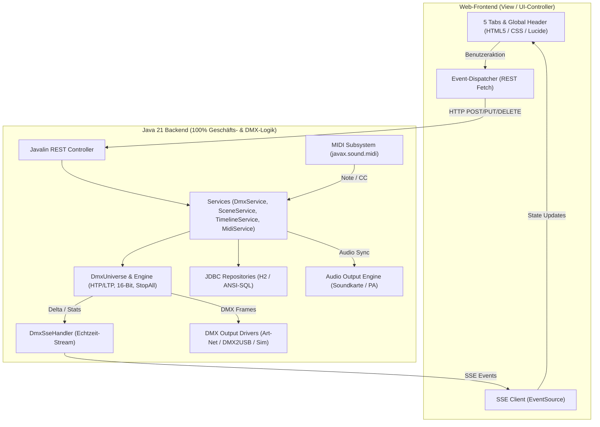

# Spezifikation: jdmx (Java DMX Controller)

> **Verbindliche Master-Spezifikation für die Software-Entwicklung**  
> Basierend auf den Anforderungen für den Vereins- und Bühnenbetrieb mit statischem Licht (Dimmer/PARs) und bewegtem Licht (Moving Heads, Scanner).  
> Konzeptionell angelehnt an die bewährte Trennung von QLC+ (Fader Desk, 2D Stage, Virtual Console, Timeline & I/O Matrix).
>
> ### 🛑 Eiserne Leitplanken für das Projekt:
> 1. **STRIKTE MVC-ARCHITEKTUR (100% BACKEND-LOGIK):**
>    - **Sämtliche Logik gehört ins Backend:** DMX-Berechnungen, HTP/LTP-Merging, Fades, Überblendungen, Chaser/FX-Engines, Audio-Sync, Grand Master/Blackout/Stop-All, Adresskollisionen und Treiber-Kommunikation laufen **ausschließlich im Java-Backend**.
>    - **Frontend ist reine View & Event-Dispatcher:** Das Web-Frontend stellt empfangene SSE-Zustände rein visuell dar und schickt Benutzerinteraktionen sofort per REST-Call an das Backend. **Keine Geschäftslogik, DMX-Berechnungen oder Timer im Browser.**
> 2. **LÜCKENLOSE DOKUMENTATION (BACKEND & FRONTEND):**
>    - **Backend:** 100% **JavaDoc** auf allen Klassen, Interfaces, Records, Enums, Feldern und Methoden (`@param`, `@return`, `@throws`, Threading-Garantien, Architektur-Begründung).
>    - **Frontend:** 100% **JSDoc** auf allen JavaScript-Modulen, Funktionen, UI-Klassen und Event-Handlern.
> 3. **OPENAPI 3.0 SPEZIFIKATION:**
>    - Sämtliche REST-Endpunkte, SSE-Streams, Daten-Schemas und Fehlercodes werden formal nach OpenAPI 3.0 Standard in [`docs/openapi.yaml`](./docs/openapi.yaml) gepflegt (Swagger-kompatibel).
> 4. **LEBENDIGES ANFORDERUNGSMANAGEMENT (LIVING REQUIREMENTS):**
>    - Anforderungen werden von Beginn an strukturiert dokumentiert (siehe Abschnitt 8).
>    - Neu aufkommende oder sich ändernde Anforderungen während der Entwicklung werden **sofort schriftlich festgehalten**, der bestehende Teil wird angepasst und im Anforderungs-Changelog dokumentiert.
> 5. **STRIKTES TEST-DRIVEN DEVELOPMENT (TDD):**
>    - Tests ZUERST mit JUnit 5 vor der Implementierung. Vor jedem Compile/Build zwingend `mvn test` (100% grün).

---

## 1. Vision & Einsatzszenario

- **Ziel:**  
  Ein modularer, latenzarmer DMX-512 Controller in Java 21 LTS mit integriertem Web-Frontend (Javalin 6).
- **Kontext:**  
  Ausstattung für Vereinsräume, Säle und Bühnen. Typisches Rigging: **U-Traverse, die auf eine Wand gerichtet ist**, bestückt mit statischen Scheinwerfern und Moving Lights.
- **Benutzergruppen:**  
  - *Lichttechniker:* Detailkontrolle über Fader, 16-Bit Pan/Tilt, DMX-Adressierung und Fixture-Profile.
  - *Vereinsmitglieder / DJs / Theke:* Einfache Live-Bedienung über ein 3×25-Button-Raster (Cues, Farben, Intensitäten, Chaser) via Browser/Tablet.

---

## 2. Die 5 Haupt-Tabs & Permanenter Global-Header

Die Web-Anwendung (`src/main/resources/public/`) besitzt einen **permanent über allen Ansichten sichtbaren Global-Header** sowie fünf dedizierte Tabs:

```text
┌─────────────────────────────────────────────────────────────────────────────────────────────────────────┐
│ [ jdmx ]  Grand Master: [████████░░] 80%  [● BLACKOUT]  [■ STOP ALL]  [Traffic: ▄▆█ 40Hz]               │
├─────────────────┬───────────────────┬──────────────────────┬──────────────────────┬─────────────────────┤
│ [1] FADER       │ [2] 2D STAGE      │ [3] LIVE MATRIX      │ [4] TIMELINE         │ [5] INPUT / OUTPUT  │
│     & UNIVERSE  │     & FIXTURES    │     (3x25 CONSOLE)   │     (AUDIO & SHOW)   │     (ARTNET/MIDI)   │
└─────────────────┴───────────────────┴──────────────────────┴──────────────────────┴─────────────────────┘
```

### Permanenter Global-Header (Immer verfügbar)
1. **Grand Master Fader:** Skaliert lineare Gesamthelligkeit (0–100%) ausschließlich für Dimmer/Shutter.
2. **Globaler Blackout-Button (`● BLACKOUT`):** Schaltet sofort alle Dimmer/Shutter aus (Pan/Tilt bleibt unangetastet).
3. **Globaler Haupt-Stop-Button (`■ STOP ALL / RELEASE ALL`):**
   - **Das Anti-QLC+-Feature:** Im Gegensatz zu QLC+ (wo Fader Desk, 2D-Monitor und Virtual Console jeweils separate, versteckte Override- und Stop-Buttons haben) stoppt dieser eine Button **sofort alles**:
     - Beendet alle aktiven Chaser, FX-Engines, Fades und Szenen.
     - Deaktiviert alle aktiven Tasten in der 3×25 Live-Matrix.
     - Setzt alle manuellen Fader-Overrides zurück.
     - Bringt das gesamte Universum in einen definierten Ruhezustand (keine "feststeckenden" Kanäle mehr).
4. **DMX-Traffic Live-Balkendiagramm (wie in DMXControl):**
   - Permanente Miniaturanzeige im Header und Detailanzeige in Tab 5.
   - Zeigt in Echtzeit als Balken:
     - **Frame-Rate (Hz / FPS):** Z. B. 30 Hz – 44 Hz Soll/Ist.
     - **DMX-Bus-Traffic & Aktivität:** Wieviele Kanäle ändern sich gerade, Leitungs-Durchsatz und Paket-Verkehr.
   - Farbcodiert: Grün (optimaler DMX-Fluss, 30–44 Hz), Gelb (erhöhte Latenz), Rot (Buffer-Drop/Stillstand).

---

### Tab 1: Fader Desk & Universum (Kanal-Ebene)
- **Zweck:** Diagnostik, Einleuchten, Testen und manuelles Eingreifen auf DMX-Kanal-Ebene.
- **Funktionen:**
  - **512-Kanal Fader-Raster:** Vertikale Schieberegler mit Kanalnummer, DMX-Wert (0–255) und Prozentwert (0–100%).
  - **Fixture-Gruppierung:** Kanäle können nach Geräten gruppiert ein- und ausgeklappt werden (z. B. *„Moving Head 1 [CH 1–16]“* mit Kanalbezeichnungen: *Pan, Pan Fine, Tilt, Tilt Fine, Dimmer, Color, Gobo...*).
  - **Flash-Buttons:** Für Dimmerkanäle (tastendes Setzen auf 255).
  - **High-Performance Canvas-Universe-Grid:** Live-Kompaktanzeige aller 512 Kanäle als 16x32-Raster mit Helligkeits-Visualisierung.

### Tab 2: 2D Stage & Fixture-Patch (U-Traverse & Wand)
- **Zweck:** Räumliche Anordnung, Adressierung und intuitive Ausrichtung von Moving Lights.
- **Funktionen:**
  - **2D-Bühnenplan:**
    - Schematische Abbildung des Raums: Konfigurierbare **U-Traverse** (Linker Schenkel, Querseite, Rechter Schenkel) und gegenüberliegende **Projektionswand**.
    - Platzierung von Fixtures via Drag & Drop oder Koordinaten.
    - Visuelle Lichtkegel (Beams), die in Echtzeit Farbton, Dimmer-Status und Schwenkwinkel (Pan/Tilt) an die Wand werfen.
  - **Fixture-Verwaltung:**
    - Anlegen/Bearbeiten von Geräten (Dimmer, RGB, RGBW, Moving Head 16-Bit, Custom).
    - Adressbelegungs-Balken (1–512) mit visueller Kollisionswarnung.
  - **Quick-Inspector (Klick auf ein Fixture):**
    - **2D-XY-Pad:** Intuitive Maus- oder Touch-Steuerung für Pan/Tilt.
    - **Invertierung:** Checkboxen für *Pan invertieren* und *Tilt invertieren* (essenziell für gespiegelte Köpfe an den beiden U-Schenkeln).
    - **Pan/Tilt Limits:** Min/Max-Begrenzer (Software-Limiter), damit Moving Heads den gewünschten Wandbereich nicht verlassen und nicht in Decke oder Publikum strahlen.
    - **RGBW-Farbwähler & Schnell-Dimmer / Shutter**.

### Tab 3: Live Matrix / Virtual Console (3 × 25 Button-Desk)
- **Zweck:** Das intuitive Live-Bedienfeld für den Showabend – optimiert für PC, Touch-Tablets und externe MIDI-Hardware.
- **Philosophie:** Komplett offenes, modulares System ohne starre Pflichtvorlagen. Der Lichtoperator belegt sich die Knöpfe und Fader selbst passend zum Setup (z. B. Reihe 1 für Moving Head Bewegung/Positionen, Reihe 2 für Farb-Overrides, Reihe 3 für Effekte, Strobe & Chaser).
- **Layout:** 3 Reihen mit je 25 Spalten = 75 frei konfigurierbare Slots.
- **Button-Typen:**
  1. **Full Cue (Vollszene):** Ruft eine komplette Lichtstimmung ab.
  2. **Selective / Partial Cues (Teilszenen mit Attribut-Maskierung):**
     - **Color-Only:** Ändert ausschließlich Farben (z. B. *„Rot“*, *„Blau“*, *„Warmweiß“*) – Position und Helligkeit bleiben unberührt.
     - **Intensity-Only:** Ändert nur die Helligkeit (z. B. *„100%“*, *„50%“*, *„Blinder Flash“*).
     - **Position-Only:** Fährt nur Pan/Tilt an – Farben und Dimmer bleiben unverändert.
  3. **Chaser & FX:** Startet zyklische Abläufe (z. B. *„Sinus-Welle über die Wand“*, *„Farbkreis“*, *„Stroboskop“*).
- **Button-Verhalten (Trigger-Modi):**
  - `TOGGLE`: Klick schaltet an / nochmal Klick schaltet aus.
  - `FLASH` (Momentary): Aktiv solange Maustaste / Touch / MIDI-Taste gehalten wird.
  - `EXCLUSIVE_GROUP` (Radio): Z. B. für Farbreihen: Die Aktivierung von *„Grün“* deaktiviert automatisch *„Rot“* oder *„Blau“*.
- **Fading:** Konfigurierbare Einblendzeit (`fadeTimeMs`) für weiche Übergänge.
- **Hardware-Anbindung:** Jede Taste kann per 1-Klick MIDI-Learn direkt auf physische Controller-Pads (z. B. Akai APC Mini, Novation Launchpad) gelegt werden.

### Tab 4: Timeline (Show & Music Sync)
- **Zweck:** Vorprogrammierte, mikrosekundengenaue Shows synchron zur Musik (z. B. für Showtänze oder Einmarsch-Hymnen).
- **Integrierte Audio-Wiedergabe (Ersetzt VLC / externe Zuspieler):**
  - Audio-Dateien (MP3, WAV, OGG) werden direkt in die Show geladen.
  - Das Audio-Signal wird **direkt über den Audio-Ausgang / die Soundkarte des Computers an das Mischpult / die Hallen-PA** ausgegeben.
  - **100% Synchronität:** Ton und Licht starten zeitgleich mit einem einzigen Druck auf *Play* – keine Timing-Verschiebungen und kein Herunterzählen mehr zwischen Ton- und Lichtmann.
- **Wellenform-Darstellung (Waveform-Display):**
  - Visuelle Wellenform der Audiodatei für millimetergenaues Arbeiten an Drops, Beats und Tempowechseln.
  - Playhead mit Zeitanzeige (Minuten:Sekunden:Millisekunden).
  - **Scrubbing & Spulen:** Beim Klick in die Zeitleiste springt das Lied sofort exakt an diese Stelle mit (ideal zum Einstudieren einzelner Tanz-Abschnitte).
  - Transport-Steuerung: Play, Pause, Stop, Loop-Marker, Lautstärkeregler.
- **Mehrspur-DMX-Zeitleiste (Light Tracks):**
  - Mehrere parallele Lichtspuren unter der Audiospur (z. B. für *Moving Heads Bewegung*, *Farben*, *Dimmer/Strobe*, *Frontlicht*).
  - Platzieren von Szenen- und Chaser-Blöcken per Drag & Drop.
  - Ziehbare Blocklänge (Dauer) und stufenlos einstellbare Fade-In / Fade-Out Kurven.

### Tab 5: Input / Output (I/O) & Diagnostik
- **Zweck:** Anbindung physischer Schnittstellen für DMX-Ausgabe, externe Controller und Bus-Überwachung.
- **DMX Outputs:**
  1. **Art-Net Output (Ethernet/UDP):**
     - Sendet DMX-Frames an Art-Net Nodes im Netzwerk (Port 6454).
     - Einstellbar: Ziel-IP (Broadcast `255.255.255.255` oder Unicast wie `192.168.1.100`), Subnetz und Universe.
  2. **DMX2USB Output (Serielle Schnittstelle / FTDI):**
     - Anbindung gängiger USB-DMX-Interfaces (z. B. Enttec DMX USB Pro, FTDI OpenDMX).
     - Plattformunabhängig implementiert über `jSerialComm`.
     - Port-Auswahl (z. B. `COM3` unter Windows, `/dev/ttyUSB0` unter Linux).
  3. **Virtual Simulator Driver:**
     - Für Entwicklung und Offline-Tests ohne Hardware.
- **MIDI Input & Mapping:**
  - Erkennt angeschlossene USB-MIDI-Controller (z. B. Akai APC Mini, Korg nanoKONTROL, Behringer X-Touch).
  - **MIDI-Learn Funktion:** Klick auf einen Regler oder Matrix-Button im UI, MIDI-Taste oder Fader am Controller bewegen ➔ Automatische Zuordnung gespeichert.
  - Unterstützte Mappings:
    - Grand Master Fader
    - Blackout-Toggle
    - Einzel- oder Submaster-Fader im Fader Desk
    - Beliebige Slots in der 3×25 Live Matrix
  - **MIDI Feedback (Option):**
    - Sendet Note-On/Off-Befehle zurück an Controller mit LED-Tasten (z. B. Launchpad / APC Mini), um aktive Cues leuchten zu lassen.
- **DMX Traffic Monitor (Diagnose wie in DMXControl):**
  - Großes Echtzeit-Balkendiagramm zur Bus-Diagnose:
    - **Framerate-Verlauf (Hz / FPS):** Soll-Wert (z. B. 40 Hz) vs. Ist-Wert.
    - **Kanalaktivitäts-Balken:** Balkendiagramm der 512 Kanäle, das anzeigt, auf welchen Adressen aktuell Aktivität/Änderung stattfindet.
    - **Paket-Zähler:** Ausgegebene Pakete pro Sekunde (PPS) und Gesamtzähler.
    - **Frame-Time / DMX-Timing:** Messung der Frame-Generierungszeit in Millisekunden (Soll: < 25 ms bei 40 Hz).

---

## 3. Architektur & MVC-Schichtenmodell



### 3.1 Das MVC-Prinzip im Detail
- **Model (Backend):**
  - Repräsentiert die gesamte Datenhaltung und den Systemzustand.
  - Klassen: `DmxUniverse`, `Fixture`, `Scene`, `MatrixButton`, `TimelineShow`, `MidiMapping`, `UniverseState`.
  - Vollständige Validierungs- und Integritätsregeln liegen hier (z. B. Adresskollisionen, Grenzwerte).
- **Controller (Backend):**
  - Javalin REST Controller (`DmxApiController`, `FixtureApiController`, `SceneApiController`, etc.) und Services.
  - Führen Berechnungen aus: HTP/LTP-Merging, Master-Skalierung, Pan/Tilt Limitering, Fading-Kurven, Stop-All Release.
- **View (Frontend):**
  - Rein reaktive Visualisierung (`src/main/resources/public/`).
  - Zeigt empfangene Werte unverzüglich im DOM / Canvas an.
  - Berechnet **keine** DMX-Werte, **keine** Überblendungen und **keine** Kollisionen vor.

### 3.2 Dokumentations- & Schnittstellen-Standards
- **JavaDoc (Backend):** 100% Abdeckung aller Klassen, Records, Interfaces, Enums, Felder und Methoden.
- **JSDoc (Frontend):** Jedes Frontend-Modul und jede JavaScript-Funktion wird mit strukturiertem JSDoc dokumentiert.
- **OpenAPI 3.0 Spezifikation:** Bereitstellung von [`docs/openapi.yaml`](./docs/openapi.yaml). Standardisiert alle Endpunkte, Payloads, Schemas und SSE-Events.

---

## 4. DMX Core Engine: Technische Leitregeln

### 4.1 HTP vs. LTP Merging
- **HTP (Highest Takes Precedence):**
  - Gilt ausnahmslos für **Dimmer- und Intensitätskanäle**.
  - Wenn mehrere Szenen oder Flash-Buttons denselben Dimmer ansprechen, gewinnt der höchste Wert.
- **LTP (Latest Takes Precedence):**
  - Gilt für **Pan, Tilt, Gobo, Farbe, Prisma und Shutter**.
  - Der zuletzt gesendete Befehl überschreibt den Wert – unabhängig davon, ob die Zahl größer oder kleiner ist.

### 4.2 Grand Master & Blackout-Regel
- **Grand Master:** Skaliert **ausschließlich** Kanäle vom Typ `DIMMER` und `SHUTTER` (`effektiv = (wert * master) / 255`).
- **Blackout:** Setzt **ausschließlich** `DIMMER`- und `SHUTTER`-Kanäle auf 0.
- **Verbotene Aktion:** Pan-, Tilt- oder Farbkanäle dürfen durch Grand Master oder Blackout **niemals verändert oder genullt werden**! Moving Heads müssen beim Blackout exakt auf ihrer aktuellen Position stehen bleiben.

### 4.3 16-Bit Pan/Tilt Behandlung
- Moving Heads nutzen 2 DMX-Kanäle pro Achse (Coarse = High Byte 0–255, Fine = Low Byte 0–255), entsprechend 65.536 Stufen.
- Die Engine berechnet Positionen intern als 16-Bit Integer (`0 .. 65535`) und teilt sie beim Frame-Export auf:
  - `Coarse = (value >> 8) & 0xFF`
  - `Fine   = value & 0xFF`

### 4.4 Globaler Release & Stop-All Engine Mechanismus
- Die DMX-Engine besitzt eine zentrale, thread-sichere Methode `stopAll()`:
  - **Sofortiger Abbruch:** Alle laufenden Chaser-Threads, Fading-Tasks und FX-Generatoren werden unverzüglich beendet (`cancel(true)`).
  - **Matrix-Deaktivierung:** Alle Buttons in der 3×25 Live-Matrix werden auf `active = false` gesetzt.
  - **Release aller Overrides:** Manuelle Fader-Haltungen im Fader Desk und in der 2D-Ansicht werden freigegeben.
  - **Reset des Ausgabepuffers:** Dimmer-Kanäle werden auf 0 gesetzt. Pan/Tilt-Werte verharren auf definierter Home-Position.

### 4.5 DMX-Traffic Messung & Frame-Timing
- Die `DmxEngine` erfasst kontinuierlich Diagnose-Metriken im Sendeloop:
  - **FPS-Counter:** Exakte Messung der tatsächlich erreichten Bildwiederholrate (Frames pro Sekunde).
  - **Frame-Time Tracker:** Zeitspanne in Nanosekunden/Millisekunden pro DMX-Zyklus.
  - **Delta-Analyzer:** Vergleicht Frame $N$ mit Frame $N-1$ und zählt veränderte DMX-Kanäle.
  - **Bus-Auslastungsfaktor:** Berechnet das Verhältnis von aktiven Daten zu Leerlaufzeiten für das Balkendiagramm.

---

## 5. Tech-Stack & Dateistruktur

- **Java-Version:** Java 21 LTS (Records, Virtual Threads, Pattern Matching).
- **Build-Tool:** **Apache Maven** (`pom.xml`) – Strikte Richtlinie, kein Gradle.
- **Web-Framework:** **Javalin 6.x** (embedded Jetty).
- **JSON:** **Jackson 2.18+** (`jackson-databind`, `jackson-datatype-jsr310`).
- **Persistenz:** **H2 Database** (`./data/jdmx_db.mv.db`) via JDBC und HikariCP. Sauberes ANSI-SQL für spätere Postgres/MySQL-Portierbarkeit.
- **Serielle Schnittstelle (USB-DMX):** `com.fazecast:jSerialComm:2.11.0`.
- **MIDI-Schnittstelle:** Java SE Standard `javax.sound.midi`.
- **Logging:** SLF4J mit `slf4j-simple`.
- **Frontend:** HTML5, CSS3 Studio Dark Theme (ohne Node/NPM-Zwang), Lucide-Icons, Canvas 2D, SSE.
- **Testing:** **JUnit 5 (Jupiter)** + Mockito / AssertJ.

### Dateistruktur
```text
jdmx/
├── pom.xml                                   # Maven Build-Deskriptor
├── .gitignore                                # Excludes für target/, data/, AGENTS.md
├── jdmx-spec.md                              # Master-Spezifikation (dieses Dokument)
├── README.md                                 # Projekt-Übersicht & Schnellstart
├── docs/                                     # Vollständige Dokumentations-Artefakte
│   ├── ARCHITECTURE.md                       # Tiefenarchitektur & Timing-Details
│   ├── ONBOARDING.md                         # Entwickler-Einarbeitungsleitfaden
│   ├── REQUIREMENTS.md                       # Strukturierter Anforderungskatalog
│   └── openapi.yaml                          # OpenAPI 3.0 REST- & SSE-Spezifikation
├── data/                                     # H2-Datenbankdateien
└── src/
    ├── main/
    │   ├── java/de/exit/jdmx/                # 100% Geschäftslogik & Services
    │   └── resources/
    │       ├── application.properties
    │       └── public/                       # Reine View & Assets (HTML/CSS/JS/Lucide)
    └── test/java/de/exit/jdmx/               # TDD Unit- & Integrationstests
```

---

## 6. Datenmodell & Schemas

### 6.1 Datamodels (Records)

#### `ChannelType.java`
```java
package de.exit.jdmx.model;

public enum ChannelType {
    DIMMER, PAN, PAN_FINE, TILT, TILT_FINE, RED, GREEN, BLUE, WHITE, SHUTTER, GOBO, SPEED, OTHER;

    public boolean isIntensity() { return this == DIMMER || this == SHUTTER; }
    public boolean isPosition() { return this == PAN || this == PAN_FINE || this == TILT || this == TILT_FINE; }
    public boolean isColor() { return this == RED || this == GREEN || this == BLUE || this == WHITE; }
}
```

#### `Fixture.java`
```java
package de.exit.jdmx.model;

import com.fasterxml.jackson.annotation.JsonIgnoreProperties;
import java.util.List;

@JsonIgnoreProperties(ignoreUnknown = true)
public record Fixture(
    String id,
    String name,
    int universe,
    int startAddress,
    FixtureType type,
    List<ChannelType> channelDefinitions,
    boolean invertPan,
    boolean invertTilt,
    int minPanPercent,   // 0 - 100
    int maxPanPercent,   // 0 - 100
    int minTiltPercent,  // 0 - 100
    int maxTiltPercent,  // 0 - 100
    double stageX,       // 0.0 - 100.0 (Position auf 2D Stage)
    double stageY        // 0.0 - 100.0
) {
    public int channelCount() {
        return channelDefinitions != null ? channelDefinitions.size() : 1;
    }

    public boolean overlapsWith(Fixture other) {
        if (this.universe != other.universe) return false;
        int thisEnd = this.startAddress + this.channelCount() - 1;
        int otherEnd = other.startAddress + other.channelCount() - 1;
        return this.startAddress <= otherEnd && other.startAddress <= thisEnd;
    }
}
```

#### `SceneScope.java` & `Scene.java`
```java
package de.exit.jdmx.model;

public enum SceneScope {
    FULL,            // Schreibt alle konfigurierten Kanäle
    COLOR_ONLY,      // Schreibt ausschließlich RGB/RGBW/Farbrad-Kanäle
    INTENSITY_ONLY,  // Schreibt ausschließlich Dimmer-Kanäle
    POSITION_ONLY,   // Schreibt ausschließlich Pan/Tilt-Kanäle
    CUSTOM           // Benutzerdefinierte Kanalliste
}
```
```java
package de.exit.jdmx.model;

import com.fasterxml.jackson.annotation.JsonIgnoreProperties;
import java.util.Map;

@JsonIgnoreProperties(ignoreUnknown = true)
public record Scene(
    String id,
    String name,
    int universe,
    SceneScope scope,
    Map<Integer, Integer> channelValues, // DMX-Kanal (1-512) -> Wert (0-255)
    int fadeTimeMs
) {}
```

#### `MatrixButton.java` (3 × 25 Grid Slot)
```java
package de.exit.jdmx.model;

import com.fasterxml.jackson.annotation.JsonIgnoreProperties;

@JsonIgnoreProperties(ignoreUnknown = true)
public record MatrixButton(
    String id,
    int row,               // 1 - 3
    int col,               // 1 - 25
    String label,          // z. B. "Wand Rot", "Cue 1", "Welle"
    String colorHex,       // Farbe der Schaltfläche im UI (z. B. "#E11D48")
    ButtonType type,       // SCENE, CHASER, FLASH, OVERRIDE
    String targetId,       // Referenzierte Scene-ID oder Chaser-ID
    ButtonMode mode,       // TOGGLE, FLASH, EXCLUSIVE
    String exclusiveGroup, // z. B. "COLORS", "POSITIONS"
    boolean active         // Aktueller Live-Zustand
) {}
```

#### `MidiMapping.java`
```java
package de.exit.jdmx.model;

import com.fasterxml.jackson.annotation.JsonIgnoreProperties;

@JsonIgnoreProperties(ignoreUnknown = true)
public record MidiMapping(
    String id,
    String deviceName,
    int midiChannel,       // 1 - 16
    MidiMessageType messageType, // NOTE_ON, CONTROL_CHANGE
    int controlNumber,     // Note-Nummer oder CC-Nummer (0-127)
    MidiTargetType targetType,   // GRAND_MASTER, BLACKOUT, MATRIX_BUTTON, FADER
    String targetId        // z. B. Button-ID oder Kanalnummer
) {}
```

#### `DmxTrafficStats.java`
```java
package de.exit.jdmx.model;

public record DmxTrafficStats(
    int fps,
    int targetFps,
    long packetsSentTotal,
    int activeChannelsCount,
    int changedChannelsCount,
    double busLoadPercent,
    double frameTimeMs
) {}
```

#### `TimelineShow.java`, `TimelineTrack.java`, `TimelineBlock.java`
```java
package de.exit.jdmx.model;

import com.fasterxml.jackson.annotation.JsonIgnoreProperties;
import java.util.List;

@JsonIgnoreProperties(ignoreUnknown = true)
public record TimelineShow(
    String id,
    String name,
    String audioFileName,
    long durationMs,
    List<TimelineTrack> tracks
) {}

@JsonIgnoreProperties(ignoreUnknown = true)
public record TimelineTrack(
    String id,
    String name,
    String colorHex,
    List<TimelineBlock> blocks
) {}

@JsonIgnoreProperties(ignoreUnknown = true)
public record TimelineBlock(
    String id,
    long startMs,
    long durationMs,
    long fadeInMs,
    long fadeOutMs,
    String sceneId
) {}
```

---

## 7. REST-API & SSE Schnittstellen

| Methode | Pfad | Beschreibung | Payload / Rückgabe |
| :--- | :--- | :--- | :--- |
| `GET` | `/api/universes/{id}` | Zustand des Universums | `UniverseState` (512 Werte, Master, Blackout) |
| `POST`| `/api/universes/{id}/channel` | Setzt einzelnen Kanal | `{ "channel": 1, "value": 255 }` |
| `POST`| `/api/universes/{id}/channels`| Setzt mehrere Kanäle | `{ "values": { "1": 255, "2": 128 } }` |
| `POST`| `/api/universes/{id}/master`  | Setzt Grand Master | `{ "value": 255 }` |
| `POST`| `/api/universes/{id}/blackout`| Schaltet Blackout ein/aus | `{ "blackout": true/false }` |
| `POST`| `/api/engine/stop-all`        | **Globaler Release & Stop:** Stoppt alle Chaser, Fades, löst Overrides & Matrix | 200 OK |
| `GET` | `/api/engine/traffic`         | DMX-Traffic-Statistiken (FPS, Bus-Last, Packets/s) | `DmxTrafficStats` |
| `GET` | `/api/fixtures` | Liste aller Fixtures | `List<Fixture>` |
| `POST`| `/api/fixtures` | Legt Fixture an (mit Kollisionsprüfung) | `Fixture` |
| `DELETE`| `/api/fixtures/{id}` | Löscht Fixture | 204 No Content |
| `GET` | `/api/scenes` | Liste aller Szenen | `List<Scene>` |
| `POST`| `/api/scenes` | Speichert aktuelle Werte als Szene | `Scene` (inkl. `scope`) |
| `POST`| `/api/scenes/{id}/recall` | Aktiviert Szene mit Überblendung | 200 OK |
| `GET` | `/api/matrix/buttons` | Alle 75 Tasten der 3×25 Matrix | `List<MatrixButton>` |
| `PUT` | `/api/matrix/buttons/{row}/{col}` | Konfiguriert einen Button | `MatrixButton` |
| `POST`| `/api/matrix/buttons/{row}/{col}/trigger` | Triggert einen Button (Klick/Flash) | `{ "action": "press" / "release" }` |
| `GET` | `/api/timeline/shows` | Liste gespeicherter Shows | `List<TimelineShow>` |
| `POST`| `/api/timeline/shows` | Erstellt/aktualisiert eine Show | `TimelineShow` |
| `POST`| `/api/timeline/shows/{id}/audio` | Lädt Audiodatei (MP3/WAV) hoch | Multipart Audio |
| `GET` | `/api/timeline/shows/{id}/audio` | Audio-Stream für PA / Browser-Ausgabe | Audio Stream (`audio/mpeg`) |
| `POST`| `/api/timeline/control` | Transport-Steuerung (Play/Pause/Stop/Seek) | `{ "action": "play", "positionMs": 1500 }` |
| `GET` | `/api/io/config` | Aktuelle Treiber- und MIDI-Konfiguration | `IOConfig` |
| `POST`| `/api/io/driver` | Ändert DMX-Treiber (Art-Net, USB, Sim) | `DriverConfig` |
| `GET` | `/api/io/midi/devices` | Liste gefundener MIDI-Hardware-Ports | `List<String>` |
| `GET` | `/api/io/midi/mappings` | Aktuelle MIDI-Zuweisungen | `List<MidiMapping>` |
| `POST`| `/api/io/midi/mappings` | Speichert MIDI-Zuweisung | `MidiMapping` |
| `POST`| `/api/io/midi/learn` | Startet MIDI-Learn-Modus | `{ "targetType": "MATRIX_BUTTON", ... }` |
| `GET` | `/api/live/stream` | **SSE-Stream:** Sendet `universe-update`, `master-update`, `matrix-update`, `traffic-update`, `timeline-tick`, `midi-event` | EventStream (`text/event-stream`) |

---

## 8. Initialer Anforderungskatalog (Living Requirements)

Alle Systemanforderungen besitzen eine eindeutige Kennung. Neue Anforderungen werden hier ergänzt, bestehende bei Modifikationen fortgeschrieben.

| ID | Kategorie | Titel / Beschreibung | Priorität | Status |
| :--- | :--- | :--- | :--- | :--- |
| **REQ-ARCH-01** | Architektur | **Strikte MVC-Trennung:** 100% aller Berechnungen und Logik im Backend; Frontend ist reine View & Event-Dispatcher. | MUST | Definiert |
| **REQ-DOC-01** | Dokumentation | **Lückenloses JavaDoc & JSDoc:** Jede Klasse/Methode im Backend und jedes Modul/Funktion im Frontend muss dokumentiert sein. | MUST | Definiert |
| **REQ-DOC-02** | Dokumentation | **OpenAPI 3.0 Spezifikation:** REST- und SSE-API müssen standardkonform in `docs/openapi.yaml` vorliegen. | MUST | Definiert |
| **REQ-DOC-03** | Dokumentation | **Living Requirements:** Kontinuierliche Pflege und Fortschreibung von Anforderungen und Spezifikation bei Änderungen. | MUST | Definiert |
| **REQ-TEST-01** | Qualität | **Striktes TDD mit JUnit 5:** Tests werden zuerst geschrieben; `mvn test` muss vor jedem Compile zu 100% grün sein. | MUST | Definiert |
| **REQ-CORE-01** | DMX Core | 512-Kanal Universe Frame-Buffer mit Thread-Sicherheit. | MUST | Definiert |
| **REQ-CORE-02** | DMX Core | **HTP/LTP Merging:** HTP für Dimmer/Shutter, LTP für Pan/Tilt/Farben. | MUST | Definiert |
| **REQ-CORE-03** | DMX Core | **Grand Master & Blackout:** Skaliert bzw. nullt nur Dimmer/Shutter; Pan/Tilt bleibt unverändert. | MUST | Definiert |
| **REQ-CORE-04** | DMX Core | **Globaler STOP ALL / RELEASE:** Sofortiger Stopp aller Chaser, Fades, Overrides und Matrix-Zustände. | MUST | Definiert |
| **REQ-CORE-05** | DMX Core | **16-Bit Pan/Tilt:** Coarse/Fine Berechnung (0..65535) für Moving Lights. | MUST | Definiert |
| **REQ-CORE-06** | DMX Core | **DMX-Traffic Messung:** FPS-Counter, Buslast-Faktor, Latenz und geänderte Kanäle in Echtzeit. | MUST | Definiert |
| **REQ-IO-01** | I/O Treiber | **Art-Net UDP Driver:** Port 6454, OpCode 0x5000, Broadcast/Unicast. | MUST | Definiert |
| **REQ-IO-02** | I/O Treiber | **DMX2USB Driver:** Serielle FTDI/Enttec-Kommunikation via `jSerialComm`. | MUST | Definiert |
| **REQ-IO-03** | I/O Treiber | **Native Java MIDI & Learn:** Erkennung von Controllern, Note/CC Zuweisung, MIDI-Feedback. | MUST | Definiert |
| **REQ-UI-01** | Frontend | **5 Haupt-Tabs:** Fader, 2D Stage, 3x25 Matrix, Timeline, Input/Output. | MUST | Definiert |
| **REQ-UI-02** | Frontend | **Permanenter Global-Header:** Master, Blackout, STOP ALL, DMX-Traffic Balken. | MUST | Definiert |
| **REQ-UI-03** | Frontend | **Design-Leitlinie:** Studio Dark Theme, 100% Lucide-Icons, absolutes Emoji-Verbot. | MUST | Definiert |
| **REQ-TIME-01** | Timeline | **Synchrone Audio-Ausgabe:** Direktes Abspielen über Computer-Soundkarte / Hallen-PA synchron zu DMX-Lichtspuren. | MUST | Definiert |
| **REQ-TIME-02** | Timeline | **Wellenform & Scrubbing:** Visuelle Audio-Waveform mit ziehbarem Playhead. | MUST | Definiert |
| **REQ-DB-01** | Persistenz | H2 Database mit HikariCP und ANSI-SQL Repositories (Postgres-ready). | MUST | Definiert |

### 8.1 Anforderungs-Changelog (Historie von Änderungen)
- **2026-09-17:** Initiale Spezifikation erstellt (Core, Fixtures, H2, REST/SSE, Web-Dashboard).
- **2026-09-17:** Erweiterung um 4-Tab-UI, U-Traversen 2D-Stage, 3x25 Live-Matrix, MIDI, DMX2USB und Partial Cues.
- **2026-09-17:** Hinzufügen des globalen STOP ALL Release-Buttons und der DMX-Traffic-Bar (wie in DMXControl).
- **2026-09-18:** Erweiterung um Tab 4 (Timeline & synchrone Audio-Wiedergabe über Soundkarte/PA).
- **2026-09-18:** Verankerung von **Strikter MVC-Architektur (100% Backend-Logik)**, **JSDoc-Frontend-Dokumentation**, **OpenAPI 3.0 Spezifikation (`docs/openapi.yaml`)** und **Living Requirements Management**.

---

## 9. Phasenweise Implementierungs-Roadmap

### Phase 1: Maven Setup, Projektgerüst & Living Requirements
- [ ] Saubere `pom.xml` mit Java 21, Javalin 6, Jackson, HikariCP, H2, SLF4J, `jSerialComm`, JUnit 5, AssertJ, Mockito.
- [ ] Maven-Plugins: Compiler (Java 21), Exec-Plugin, Shade-Plugin (Fat-JAR mit `de.exit.jdmx.Main`), Surefire-Plugin.
- [ ] Einstiegsklasse `Main.java` und Konfiguration `AppConfig.java` mit lückenlosem JavaDoc.
- [ ] Anlegen der Dokumenten-Struktur (`docs/REQUIREMENTS.md`, `docs/ARCHITECTURE.md`, `docs/ONBOARDING.md`, `docs/openapi.yaml`).
- [ ] **TDD Schritt:** `AppConfigTest.java` schreibt Konfigurationstests zuerst.
- [ ] **Verifikation:** `mvn test` läuft grün; `mvn clean compile` und `mvn exec:java` startet Server auf Port 7070.

### Phase 2: DMX Domain Core mit HTP/LTP, Master, 16-Bit & Stop-All (TDD-First)
- [ ] **TDD Schritt 1:** `DmxUniverseTest.java` & `DmxEngineTest.java` schreiben:
  - 512-Kanal-Puffer, Thread-Sicherheit.
  - HTP-Regel für Dimmer, LTP-Regel für Pan/Tilt/Color.
  - Grand Master & Blackout isoliert auf Dimmer/Shutter.
  - 16-Bit Pan/Tilt Coarse/Fine Splitting.
  - `stopAll()` Mechanismus: Sofortiges Zurücksetzen aller States.
  - DMX-Traffic Metriken (FPS, geänderte Kanäle, Buslast).
- [ ] **TDD Schritt 2:** Implementierung im Backend (`de.exit.jdmx.core`).
- [ ] **Dokumentation:** 100% JavaDoc für alle Core-Klassen und Methoden.
- [ ] **Verifikation:** `mvn test` läuft zu 100% grün durch.

### Phase 3: Relationale Persistenz (H2 / ANSI-SQL) (TDD-First)
- [ ] **TDD Schritt 1:** Integrationstests für alle Repositories gegen In-Memory H2 DB schreiben (`JdbcFixtureRepositoryTest`, `JdbcSceneRepositoryTest`, etc.).
- [ ] **TDD Schritt 2:** Implementierung:
  - `DatabaseConfig.java` (HikariCP) und `DatabaseInitializer.java` (idempotente DDL-Migration).
  - Repositories: `FixtureRepository`, `SceneRepository`, `MatrixButtonRepository`, `TimelineRepository`, `MidiMappingRepository`.
- [ ] **Dokumentation:** 100% JavaDoc für Modelle, Repositories und SQL-Schema.
- [ ] **Verifikation:** `mvn test` läuft zu 100% grün.

### Phase 4: DMX Output-Treiber (Art-Net & DMX2USB) (TDD-First)
- [ ] **TDD Schritt 1:** `ArtNetDriverTest.java` & `DmxUsbDriverTest.java` schreiben (Header-Prüfung, Byte-Arrays, Exception-Handling).
- [ ] **TDD Schritt 2:** Implementierung:
  - `ArtNetDriver.java` (UDP Port 6454, OpCode `0x5000`).
  - `DmxUsbDriver.java` (`jSerialComm`, Break/MAB-Timing).
  - Treiber-Manager zur Umschaltung zur Laufzeit.
- [ ] **Dokumentation:** 100% JavaDoc für Treiber und Schnittstellen.
- [ ] **Verifikation:** `mvn test` läuft zu 100% grün.

### Phase 5: MIDI-Subsystem (Native Java MIDI) (TDD-First)
- [ ] **TDD Schritt 1:** `MidiServiceTest.java` mit gemockten MIDI-Nachrichten (Note-On/Off, CC) schreiben.
- [ ] **TDD Schritt 2:** Implementierung:
  - `MidiService.java` (`javax.sound.midi`): Erkennung, Listener, MIDI-Learn Manager, Event-Dispatcher.
- [ ] **Dokumentation:** 100% JavaDoc.
- [ ] **Verifikation:** `mvn test` läuft zu 100% grün.

### Phase 6: REST API, OpenAPI 3.0 & SSE Realtime Engine (TDD-First)
- [ ] **TDD Schritt 1:** API Controller Tests schreiben (`DmxApiControllerTest`, `FixtureApiControllerTest`, `TimelineApiControllerTest`, etc.).
- [ ] **TDD Schritt 2:** Implementierung aller Javalin Controller und des `DmxSseHandler.java`.
- [ ] **Dokumentation:**
  - 100% JavaDoc auf allen Controllern.
  - Vollständige OpenAPI 3.0 Spezifikation in `docs/openapi.yaml` erstellen.
- [ ] **Verifikation:** `mvn test` läuft grün; HTTP-Endpunkte und SSE-Stream liefern korrekte JSON-Payloads.

### Phase 7: Web-Frontend (Die 5 Tabs mit Lucide-Icons & reine View)
- [ ] **Architektur:** Reine View & Event-Dispatcher – keine Geschäftslogik im Browser!
- [ ] **JSDoc-Pflicht:** Jedes JavaScript-Modul wird lückenlos mit JSDoc dokumentiert.
- [ ] **Basis-Layout & Theme:** Studio Dark Theme, permanenter Global-Header (Master, Blackout, STOP ALL, DMX-Traffic Balken), 100% Lucide-Icons (keine Emojis!).
- [ ] **Tab 1 (Fader & Universum):** 512-Kanal Fader Desk mit Canvas Universe Grid.
- [ ] **Tab 2 (2D Stage & Fixtures):** U-Traverse, Wand-Projektion, Beams, Quick-Inspector mit 2D-XY-Pad und Limitern.
- [ ] **Tab 3 (Live Matrix):** 3×25 Button-Grid mit freier Belegbarkeit, Partial Cues und MIDI-Feedback.
- [ ] **Tab 4 (Timeline):** Show-Designer mit Waveform, Audio-Wiedergabe über PA, Playhead, Scrubbing und DMX-Spuren.
- [ ] **Tab 5 (Input / Output):** Art-Net, USB Port-Auswahl, MIDI-Learn Dialog und DMX-Traffic Monitor.
- [ ] **Verifikation:** End-to-End-Test: Fader, 2D Stage, Matrix, Timeline und I/O reagieren synchron und latenzfrei.

### Phase 8: Polish, Living Requirements Abgleich & Standalone Fat-JAR
- [ ] Erstellung & Finalisierung der Pflicht-Dokumente:
  - `docs/ONBOARDING.md`: Leitfaden für neue Entwickler.
  - `docs/ARCHITECTURE.md`: Tiefendokumentation (HTP/LTP, Threading, Timing, Audio-DMX-Sync).
  - `docs/REQUIREMENTS.md`: Finaler Abgleich aller Anforderungen (Status: Erfüllt).
  - `docs/openapi.yaml`: Validierung gegen Swagger-Tools.
  - `README.md`: Vollständige Produktanleitung.
- [ ] JavaDoc & JSDoc Vollständigkeitsprüfung.
- [ ] Maven Fat-JAR Build (`mvn clean package`).
- [ ] **Verifikation:** Standalone-Start via `java -jar target/jdmx-1.0.0-SNAPSHOT.jar`.
